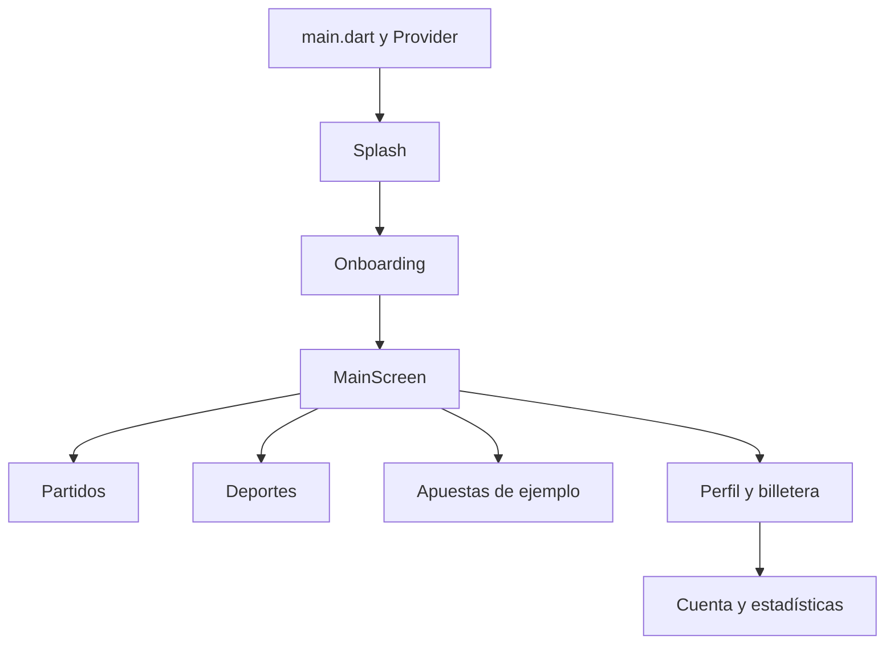

# Auditoría del stack y actualización de dependencias

Fecha: 11 de octubre de 2026. Proyecto: GoBet V1.1. Revisión del código Flutter, paquetes directos y transitivos, configuración Android, configuración iOS, recursos y herramientas locales.

## Resultado principal

La base recibida es una plantilla de interfaz de CodeCanyon. Contiene pantallas de partidos, deportes, apuestas, estadísticas, noticias, perfil y billetera, pero no implementa un servicio real de apuestas, autenticación, pagos ni resultados en vivo. La documentación original también la describe como un UI kit. Actualizar paquetes permite mantener y compilar esta interfaz; las funciones de negocio requieren una implementación adicional.

Se migró a Flutter 3.47.7 estable / Dart 3.13.5, que ya estaban instalados en el equipo. No fue necesario sustituir el SDK global. Se resolvieron los paquetes con Pub y se regeneró `pubspec.lock` usando las versiones compatibles disponibles.

## Arquitectura y componentes

| Capa | Implementación encontrada | Evaluación |
| --- | --- | --- |
| Arranque | `lib/main.dart`, Provider y MaterialApp | Entrada única, splash de cuatro segundos y onboarding de tres páginas. |
| Navegación | Navigator, MaterialPageRoute y page_transition | Navegadores por pestaña en MainScreen; no hay enrutador declarativo ni autenticación que restrinja rutas. |
| Estado | StatefulWidget, setState y ColorNotifire con ChangeNotifier | Provider se usa principalmente para colores. No hay una capa de dominio, repositorios o servicios. |
| Diseño | Material, Cupertino, flutter_screenutil | Muchas dimensiones se calculan a partir de MediaQuery; existen inicializaciones de ScreenUtil en diferentes pantallas. Se conserva Material 2 para el diseño de la plantilla. |
| Gráficos | fl_chart en estadísticas | Datos de ejemplo definidos dentro de los widgets. |
| Tabs | buttons_tabbar y DefaultTabController | Pestañas de partidos y apuestas con contenido de demostración. |
| Cuenta | TextField y navegación entre pantallas | No hay formularios con validación, control de sesión ni peticiones de autenticación. Los campos de contraseña requieren implementar ocultación y validación antes de un uso real. |
| Billetera | Pantallas y valores escritos en el código | No se encontró SDK de pagos, tokenización, contabilidad ni transacciones remotas. |
| Persistencia | Ninguna implementación activa | shared_preferences estaba declarado pero no importado. Se retiró. |
| Red y backend | Ninguna implementación encontrada | No hay cliente HTTP/Dio, Firebase, sockets, base de datos ni configuración de API. |
| Recursos | 162 imágenes; 20 archivos de fuente, seis familias declaradas | Recursos locales. Se corrigieron nombres de familias que no coincidían con pubspec. |
| Código nativo Android | MainActivity Kotlin / FlutterActivity, embedding v2 | No contiene servicios nativos adicionales. |
| Código nativo iOS | Swift, UIKit y Flutter | AppDelegate y SceneDelegate; integración con el motor implícito de Flutter. |
| Verificación | Pruebas Flutter y análisis estático | La carpeta test original no contenía pruebas. Se incorporaron pruebas para las rutas y componentes afectados. |

## Dependencias

Las versiones anteriores de la tabla son las resueltas en el lock original, no solamente los mínimos del pubspec.

| Paquete | Antes | Después | Cambio |
| --- | --- | --- | --- |
| flutter_screenutil | 5.9.0 | 5.9.3 | Actualizado. |
| dotted_border | 2.1.0, sin restricción explícita | 3.1.0 | API migrada a RoundedRectDottedBorderOptions. |
| buttons_tabbar | 1.3.8 | 1.3.15 | Actualizado. |
| fl_chart | 0.64.0 | 1.2.0 | Actualizado y probado con la pantalla de estadísticas. |
| provider | 6.1.1 | 6.1.5+1 | Actualizado. |
| page_transition | 2.1.0 | 2.2.2 | Actualizado y probado con splash/onboarding/pestañas. |
| clock | 1.1.1, transitivo | 1.1.3, directo | Reloj comprobable para el temporizador local. |
| flutter_launcher_icons | 0.13.1, producción | 0.14.4, desarrollo | Configuración corregida bajo flutter_launcher_icons; elimina alfa para iconos iOS al regenerarlos. |
| flutter_lints | 1.0.0 mal ubicado en la configuración de iconos | 6.0.0, desarrollo | Ahora instalado e incluido en analysis_options.yaml. |
| flutter_countdown_timer | 4.1.0 | Retirado | Su SDK exige Dart menor que 3. Sustituido por un widget local con cancelación, actualización de plazo y recuperación al volver del segundo plano. |
| flutter_onboarding_screen | 2.0.2 | Retirado | No se usaba y su SDK exige Dart menor que 3. El onboarding ya utiliza PageView. |
| shared_preferences | 2.2.2 | Retirado | No tenía usos en el código. También desaparecen sus plugins nativos transitivos. |
| cupertino_icons | 1.0.6 | Retirado | No había referencias a CupertinoIcons; CupertinoSwitch proviene del SDK Flutter. |

Pub informa que todas las dependencias directas y de desarrollo están actualizadas. Cuatro transitivas mantienen versiones compatibles: equatable 2.1.0 frente a 3.0.0; material_color_utilities 0.13.0 frente a 0.13.1; cli_util 0.4.2 frente a 0.6.0; test_api 0.7.12 frente a 0.7.15. Las restricciones de los paquetes padres o del SDK impiden resolver las versiones más nuevas. No se introdujeron dependency_overrides.

## Android

| Elemento | Antes | Configuración final |
| --- | --- | --- |
| Flutter Gradle | apply from imperativo | Bloques plugins y dev.flutter.flutter-plugin-loader. |
| Android Gradle Plugin | 4.1.0 | 9.4.1. |
| Gradle | 7.6.1 | 9.6.0. |
| Kotlin | 1.6.10 | 2.4.0; compilación integrada en AGP. |
| Java del código | 8 | 17. |
| JDK de compilación local | No configurado en el proyecto | JDK 25.0.3 de Android Studio, detectado por Flutter. |
| compileSdk / targetSdk | Valores del antiguo Flutter | API 37. |
| minSdk | Valor del antiguo Flutter | Valor del SDK Flutter actual: API 24, Android 7.0. |
| NDK | No fijado | r30 LTS, 30.0.16248370. |
| Namespace / applicationId | com.example.gobet | Se conserva com.example.gobet y se declara namespace explícito. |

AGP 9.4 admite API 37 y exige Gradle 9.6. Se utiliza el NDK r30 LTS disponible, confirmado en la documentación Android. Se retiró package de los manifiestos para delegar el namespace al archivo Gradle. Se eliminaron la dependencia obsoleta kotlin-stdlib-jdk7, Jetifier y las opciones JVM duplicadas.

Se mantiene android.newDsl=false porque la integración Gradle de Flutter aún utiliza interfaces antiguas. android.builtInKotlin=true activa Kotlin integrado. La declaración de Kotlin en settings resuelve la versión del compilador, pero no aplica kotlin-android al módulo de la app. Esta distinción evita usar el Kotlin 2.2.10 que AGP aporta por defecto, inferior al mínimo comprobado por Flutter 3.47.

local.properties ahora apunta al SDK de este equipo. Es un archivo local ignorado por Git; cada equipo debe generar sus propias rutas.

La configuración release conserva la firma de depuración de la plantilla. Antes de distribuir, debe configurarse un keystore privado y un identificador propio. Compilar un APK de prueba no equivale a preparar una publicación.

## iOS y documentación de Apple

Se actualizó el mínimo de iOS de 9.0 a 15.0 en Xcode y AppFrameworkInfo.plist. Este mínimo procede del SDK Flutter actual; no es un requisito general de Apple para todas las aplicaciones. Swift mantiene el modo de lenguaje 5.0, como la plantilla del SDK Flutter instalado. SWIFT_VERSION selecciona el modo del lenguaje y no representa la versión instalada de Xcode.

Se incorporaron SceneDelegate.swift y sus referencias en el proyecto Xcode. Info.plist declara UIApplicationSceneManifest, UIWindowSceneSessionRoleApplication, la clase SceneDelegate y el storyboard Main. UIApplicationSupportsMultipleScenes permanece en false: la app no implementa coordinación de ventanas múltiples. UIKit crea y conecta el delegado a partir de esa configuración, tal como indica [Apple sobre escenas](https://developer.apple.com/documentation/uikit/specifying-the-scenes-your-app-supports).

AppDelegate utiliza @main y FlutterImplicitEngineDelegate; el registro de plugins se realiza cuando Flutter inicializa su motor implícito. La adaptación concreta al motor es de Flutter; la configuración de escenas y el ciclo de vida se contrastaron con [UISceneDelegate de Apple](https://developer.apple.com/documentation/uikit/uiscenedelegate).

Se añadió el Podfile que faltaba y las inclusiones opcionales de configuración de CocoaPods para Debug/Release; Profile utiliza la configuración Release existente. El proyecto no tiene RunnerTests nativo, así que no se añadió ese target al Podfile. ENABLE_USER_SCRIPT_SANDBOXING=NO permite los scripts de compilación del SDK Flutter, siguiendo su plantilla. [Apple define esta opción](https://developer.apple.com/documentation/xcode/build-settings-reference) como una restricción sobre las entradas/salidas de scripts, distinta del sandbox de ejecución de la aplicación.

Se comprobó que los plist y los manifiestos Android son XML válido. No se ejecutaron pod install, xcodebuild, simulador ni firma iOS: este equipo es Windows. Es necesaria una compilación en macOS con Xcode y Flutter 3.47.7 antes de considerar iOS validado.

Referencias primarias consultadas:

- [Apple: UISceneDelegate](https://developer.apple.com/documentation/uikit/uiscenedelegate): eventos de ciclo de vida por escena.
- [Apple: configuración de escenas](https://developer.apple.com/documentation/uikit/specifying-the-scenes-your-app-supports): manifest, delegado, storyboard y soporte de varias escenas.
- [Apple: configuración de compilación Xcode](https://developer.apple.com/documentation/xcode/build-settings-reference): modo Swift y sandbox de scripts.
- [Flutter: adopción de UIScene](https://docs.flutter.dev/release/breaking-changes/uiscenedelegate): conexión entre UIKit y el motor Flutter.
- [Flutter: migración Gradle](https://docs.flutter.dev/release/breaking-changes/flutter-gradle-plugin-apply): aplicación declarativa de plugins.
- [Flutter: Kotlin integrado](https://docs.flutter.dev/release/breaking-changes/migrate-to-built-in-kotlin/for-app-developers): requisitos para apps Flutter.
- [Android: AGP 9.4](https://developer.android.com/build/releases/agp-9-4-0-release-notes): compatibilidad de Gradle y API 37.
- [Android: NDK](https://developer.android.com/ndk/downloads): versión r30 LTS.
- [pub.dev](https://pub.dev/): versiones, restricciones SDK y APIs de paquetes; versiones exactas registradas en pubspec.lock.

## Correcciones de compatibilidad

Además del temporizador y dotted_border, se sustituyeron showTrackOnHover por trackVisibility, activeColor de CupertinoSwitch por activeTrackColor y withOpacity por withValues. Se corrigieron un import no usado, un color hexadecimal inválido, llaves de bloques y claves de constructores. Se canceló el timer del splash al cerrar la pantalla y se liberan los PageController de onboarding, deportes y estadísticas.

Se habilitaron flutter_lints. Se conservan excepciones explícitas de estilo para nombres heredados, tipos de retorno de métodos de UI, uso de super, tamaño de contenedores y orden de propiedades. El análisis limpio corresponde a esta configuración; no significa que la plantilla cumpla todas las reglas opcionales sin excepciones.

## Validación

- flutter pub get / pub upgrade: dependencias resueltas y lock regenerado.
- flutter pub outdated: todos los paquetes directos y de desarrollo actualizados; cuatro transitivos limitados por sus padres.
- flutter analyze: sin incidencias con la configuración documentada.
- flutter test: nueve pruebas aprobadas, con tipografías reales cargadas para la comprobación de UI.
- Cobertura: splash y transición, cierre de splash, cuatro pestañas principales, borde actualizado, gráficos, expiración del temporizador, plazo vencido, cambio de plazo/cancelación y regreso del segundo plano.
- Compilación Android debug: APK generado correctamente en build/app/outputs/flutter-apk/app-debug.apk. Registro en docs/validation/android-build-debug.log.
- Compilación Android release: APK generado correctamente en build/app/outputs/flutter-apk/app-release.apk (59,4 MB según Flutter). Registro en docs/validation/android-build-release.log. Sigue firmado con la clave de depuración de la plantilla; no es una publicación preparada para tienda.
- Ejecución Android: APK release instalado y abierto en Medium Phone API 37.0, emulator-5554. MainActivity confirmada en primer plano y onboarding visible; captura en docs/validation/android-emulator.png.
- iOS: configuración revisada; compilación y ejecución pendientes en macOS/Xcode.

Las pruebas no cubren cada interacción, todos los tamaños de pantalla, teclado, accesibilidad, giro ni ejecución en dispositivos reales. El proyecto incluye relaciones de tamaños y listas de ejemplo que requieren una revisión de producto antes de publicar.

## Trabajo funcional pendiente detectado

1. Implementar autenticación, validación de entradas, sesión y almacenamiento seguro antes de utilizar datos reales. Las pantallas de acceso y registro actualmente navegan sin verificar credenciales.
2. Construir una API y una capa de dominio para partidos, cuotas, apuestas y resultados; sustituir los datos de ejemplo.
3. Integrar un proveedor de pagos con tokenización. Los formularios y saldos actuales son demostraciones.
4. Revisar ColorNotifire: su setter no llama a notifyListeners y varias variables de color son públicas. El modo oscuro no constituye una función completa.
5. Unificar la adaptación de tamaño y revisar pantallas pequeñas, orientación y accesibilidad. La app declara soporte de paisaje e iPad, pero esto no demuestra que cada pantalla esté adaptada.
6. Configurar identificadores, firma Android y equipo/certificados iOS para distribución. Preparar las pruebas en dispositivos reales y los archivos de privacidad cuando se incorporen servicios que los necesiten.

La copia completa del estado recibido está en `../maintenance-backup-2026-10-11/Gobet V1.1`. La carpeta recibida no era un repositorio Git; no se crearon commits ni se publicó el proyecto.

