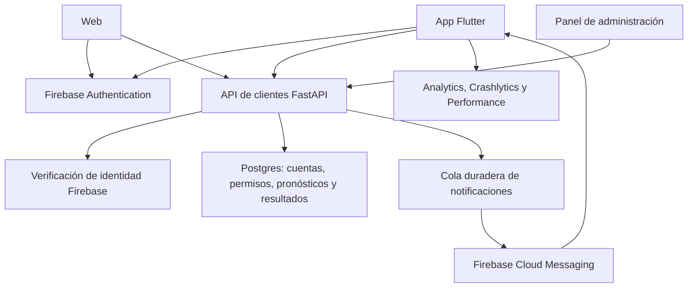

# Flutter + Firebase + backend QuantFut: revisión y plan de integración

**Actualización posterior del mismo día:** el usuario autorizó conectar contenido
real y eliminar el modo demo. La app ya usa la API de clientes existente y los
módulos móviles de contenido y monedas; Firebase sigue pendiente. Ver
[estado actual](APP_REAL_MONEDAS_REFERIDOS_20261011.md). La auditoría y decisión
de fase 0 siguientes conservan el contexto anterior a esa autorización.

Fecha: 11 de octubre de 2026. Alcance: análisis local de la app, API de clientes, cuentas, suscripciones, panel y documentación oficial. Propuesta técnica; no es una integración desplegada. Complementa `PLAN_FIREBASE_SUSCRIPCIONES.md`, cuya propuesta de Firestore como almacén principal no tiene en cuenta toda la infraestructura comercial ya existente en este repositorio.

## Nueva decisión: registro como primera pantalla (pendiente, no ejecutar)

El usuario pidió que el primer acceso a la app sea una pantalla de registro y
acceso como la captura `codex-clipboard-9da919e1-f27f-400b-8c67-6b5038e0fb25.png`.
**Solo registrar el requisito en el plan de Firebase; no implementar, compilar
ni desplegar este cambio todavía.** Esta decisión sustituye el recorrido
propuesto de explorar como visitante antes de registrarse.

- Primera pantalla funcional para una persona sin sesión: registro/acceso,
  antes de las bienvenidas y del calendario. El arranque técnico puede cargar
  la sesión, pero no abrir contenido protegido antes de resolverla.
- Adaptar la referencia a QuantFut: fondo oscuro, marca propia, título breve,
  bloque de beneficios y botón principal de acceso con Google mediante Firebase
  Authentication. El mismo acceso resolverá alta nueva o cuenta existente;
  conservar el plan de vinculación con la cuenta del backend y sus permisos.
- Selector de idioma visible en la esquina superior, disponible antes del
  registro. Elegir idioma en esta pantalla y conservarlo al continuar: seis
  idiomas previstos. No anteponer una pantalla obligatoria de idioma al registro.
- Enlaces accesibles a términos de uso y política de privacidad, con aceptación
  explícita antes de continuar. La referencia no implica consentimiento marcado
  automáticamente; dejarlo sin seleccionar. Anotar versión y fecha de aceptación
  en la cuenta/backend. Mantener las preferencias opcionales de medición y
  marketing separadas del acceso.
- Las cifras de precisión, usuarios y datos por partido de la captura son
  referencias visuales. Usar métricas reales respaldadas por el proyecto y su
  muestra; omitir cualquier cifra que no esté disponible. No copiar la marca ajena.
- Después de autenticar y resolver la cuenta: bienvenidas solo cuando aún no se
  hayan completado; después, Inicio. Con sesión válida al reabrir, entrar a Inicio
  sin exigir otro registro. Al cerrar sesión, volver a la pantalla de acceso.
- Prever cancelación de Google, falta de conexión, error de autenticación,
  sesión caducada y conflicto con cuenta existente sin crear perfiles duplicados
  ni perder suscripción, saldo de monedas o referidos.

Criterios de aceptación futuros: registro primero en instalación nueva y sin
sesión; idioma elegible antes de autenticar; Google abre el flujo real; cancelar
o fallar conserva la pantalla y no da acceso; aceptación comprobada y persistida;
sesión restaurada sin repetir el alta; vinculación conserva derechos y saldo.
Todo sigue pendiente de la autorización del usuario para implementarlo.

## Decisión del usuario: pantallas antes de implementación

El usuario confirmó el 11 de octubre que la implementación será por fases y que primero facilitará sus ideas de pantallas. Antes de iniciar integración funcional, definir una fase 0 de producto: revisar sus propuestas, aportar opiniones/recomendaciones y adaptar navegación, contenido, permisos, medición y avisos a la web y al proyecto de fútbol/NBA.

El orden técnico de este documento es provisional hasta concretar ese diseño. De cada pantalla se documentarán objetivo, datos reales disponibles, estados de carga/error/vacío, acceso gratuito/premium, acciones, eventos de medición y enlaces/notificaciones relacionados. Después se cerrarán entregables y criterios de aceptación por fase. Pendientes registrados también en `harness/tareas.md`.

## 1. Resultado y arquitectura recomendada

Actualización de diseño: recibidas las primeras referencias del usuario e
implementado el prototipo de bienvenidas, navegación de cinco pestañas y
acceso a planes VIP. Detalles, límites y fases de producto en
`PANTALLAS_BIENVENIDA_INICIO_VIP_20261011.md`. Esta entrega no inicia la
integración Firebase ni modifica el backend.

Conservar FastAPI/Postgres como autoridad de pronósticos, resultados, planes, acceso premium y auditoría. Incorporar Firebase Authentication para identidad, Cloud Messaging para avisos y Analytics/Crashlytics/Performance para conocer uso y calidad. Registrar Android, iOS y la web del mismo producto en el mismo proyecto de producción; separar desarrollo y pruebas de producción.

Firestore, Storage y Cloud Functions son opcionales en esta arquitectura. No es necesario trasladar el modelo deportivo, el histórico ni la base comercial a Firebase. El VPS puede verificar identidades y enviar avisos con el Admin SDK Python.

El diagrama representa el destino propuesto. Hoy la web autentica mediante tokens opacos propios, la app es una plantilla y todavía no existe la cola FCM.

## 2. Evidencia del proyecto

| Evidencia local | Hallazgo | Consecuencia |
|---|---|---|
| `lib/main.dart`, `pubspec.yaml` | 62 archivos Dart; sin Firebase ni cliente HTTP | Inicializar Firebase y construir servicios/repositorios antes de conectar pantallas |
| `lib/log_in/login/login.dart:196` | Log In navega a términos; contraseña sin ocultación | Sustituir navegación por autenticación real y validación |
| `lib/sign_in/signup.dart:154` | Registro abre Profile directamente | Crear identidad real y gestionar correo verificado |
| `lib/forget_password/` | Recuperación/cambio solo cambian pantallas | Usar acciones de Auth y mostrar resultado confirmado |
| `lib/onbonding_screen/splesh_screen.dart` | Espera fija de cuatro segundos | Arranque ligado a inicialización/sesión; onboarding solo cuando corresponda |
| `lib/bottombar.dart` | Cuatro navegadores Offstage | Registrar únicamente la pestaña/ruta visible y resolver enlaces entrantes |
| `lib/.../notification/notification.dart:59` | Enable abre una lista | Falta permiso del sistema, registro de dispositivo y manejo FCM |
| `lib/.../notification/notification_list.dart` | Fecha y avisos de ejemplo | Bandeja persistente, lectura y paginación |
| `lib/.../user_profile.dart` | Switch cambia estado local | Preferencias persistentes y comportamiento comprobable |
| `lib/.../statistic/month.dart` | Puntos de gráfica escritos en el widget | Consultar agregados reales; diferenciar uso de app y rendimiento deportivo |
| `lib/.../profile.dart` y `wallet/` | Nombre, saldos y operaciones de ejemplo | Cuenta real y suscripción; no tratar esos saldos como operaciones implementadas |
| `lib/utils/color_notifire.dart` | Setter no llama notifyListeners | Corregir y guardar tema; unificar adaptación de tamaño |
| `android/app/src/main/AndroidManifest.xml` | No declara INTERNET; debug/profile sí | Revisar manifiesto fusionado release y conexión HTTPS |
| `android/app/build.gradle` | ID de ejemplo y release firmado con debug | Identificadores definitivos y firma antes de configurar producción |
| `ios/Flutter/Generated.xcconfig` | Ruta generada de la copia anterior | Regenerar en Mac; validar Xcode, firma y APNs |
| `src/qf/api/cuentas.py` | `/app/v1` ya incluye cuentas, perfil, planes y picks | Adaptar API existente en vez de construir otro backend completo |
| `src/qf/comercial/cuentas.py` | Contraseñas Argon2; sesiones en Postgres/Redis | Hace falta estrategia explícita de transición de identidad |
| `db/043_cuentas.sql` | password_hash obligatorio; suscripciones y auditoría inmutables | Migraciones compatibles para identidades externas y eventos comerciales |
| `src/qf/api/panel.py` | Usuarios, planes, concesiones, revocación y cierre de sesiones | Extender el panel y coordinar las acciones con Firebase |
| `src/qf/comercial/metricas.py` | Actividad basada en último login; ingresos desde concesiones payment | No confundir login con uso activo ni permiso con contabilidad completa |

La revisión anterior en esta misma conversación ejecutó `flutter analyze --no-pub` y las nueve pruebas existentes desde `apps/mobile`, con resultados correctos. Esta ampliación revisa código/documentación sin cambios funcionales y no repite esas comprobaciones. Las pruebas actuales no cubren Auth, FCM, compras, permisos ni integración remota. No se ha validado Firebase en un dispositivo ni recompilado iOS.

## 3. Servicios y paquetes

| Servicio/paquete | Uso en este proyecto | Prioridad |
|---|---|---|
| `firebase_core` | Inicialización y configuración por ambiente | P0 |
| `firebase_auth` | Correo/contraseña, recuperación y proveedores sociales elegidos | P0 |
| `firebase_analytics` | Eventos de uso, embudo y retención | P0 |
| `firebase_crashlytics` | Fallos fatales y recuperables | P0 |
| `firebase_messaging` | Avisos push, tokens y aperturas | P1 |
| `firebase_app_check` | Comprobar origen de peticiones junto a identidad/permisos | P1 |
| `firebase_performance` | Duración de cargas y peticiones | P1 |
| `firebase_remote_config` | Banners y activación gradual de interfaz | P1 |
| `cloud_firestore` | Opcional: sincronización directa de datos específicos | P2 |
| `firebase_storage` | Opcional: avatares/adjuntos con reglas y límites | P2 |
| `cloud_functions` | Solo si se eligen funciones remotas en Firebase | P2 |
| BigQuery, A/B Testing, In-App Messaging | Análisis y experimentos después de validar medición | P2 |

Además: un cliente HTTP como Dio o http, rutas con enlaces entrantes, modelos de respuesta y una capa de repositorios. Elegir versiones contra el SDK instalado y ejecutar pruebas nativas tras agregar plugins. No actualizar automáticamente todo el stack para añadir Firebase.

Firebase Auth persiste su sesión en Android/iOS; no implementar otro almacén manual de contraseñas o refresh tokens Firebase. Si durante una transición se conservan tokens opacos del backend, su almacenamiento y rotación son un flujo separado con las reglas de `docs/app_api_flutter.md`.

Fuente: [configuración FlutterFire](https://firebase.google.com/docs/flutter/setup?hl=es-419), [estado de autenticación](https://firebase.google.com/docs/auth/flutter/start).

## 4. Cuentas y transición de usuarios existentes

Destino propuesto: Firebase identifica al usuario y Postgres decide lo que puede consultar. Un `firebase_uid` se vincula de forma única con `account_id`; se conservan suscripciones e historial de esa cuenta.

1. Añadir una tabla de identidades con proveedor, UID único y account_id, sin convertir el correo en clave de autorización.
2. Adaptar el alta de cuentas externas: `accounts.password_hash` actualmente es obligatorio. Una cuenta Google/Apple no debe recibir una contraseña ficticia para satisfacer esa columna.
3. Resolver cuentas existentes antes de abrir nuevas altas Firebase. No vincular automáticamente una identidad con una cuenta pagada únicamente porque declara el mismo correo. Exigir prueba de control de la cuenta existente, reautenticación y resolución explícita de conflictos.
4. Las contraseñas actuales son Argon2. La documentación de importación consultada no enumera Argon2 entre sus mecanismos de hash soportados; no se presupone una importación directa. Evaluar migración mediante restablecimiento, o un puente temporal donde el backend verifica el acceso antiguo y emite un custom token Firebase para el UID ya vinculado. El custom token se intercambia en el SDK; no es el ID token que acepta la API.
5. Un puente con custom tokens conserva temporalmente autenticación propia: no convierte por sí solo al usuario en una cuenta de email/password administrada por Firebase. Definir su fin y evitar cambios de contraseña incompatibles entre web y app.
6. Migrar también el acceso de la web para compartir identidad. Conservar temporalmente sesiones antiguas mediante rutas/validadores explícitos; no aceptar tokens arbitrarios ni decidir su tipo por apariencia.
7. Suspensión: verificar estado local en cada operación protegida, además de identidad. Coordinar deshabilitación/revocación Firebase y cierre de sesiones locales. Los listeners Flutter no garantizan detectar cambios administrativos inmediatamente; refrescar el usuario cuando corresponda y gestionar rechazos del backend.
8. Eliminar cuenta: reautenticación reciente, desvinculación de dispositivos y proceso coordinado Firebase/Postgres. Definir anonimización y conservación necesaria de registros económicos/auditoría, porque las tablas existentes prohíben borrados indiscriminados. Borrar la cuenta no equivale a cancelar una suscripción de tienda.

Pantallas: visitante, alta, verificación, login, olvido, cambio de proveedor, perfil, cierre de sesión y eliminación. Google/Apple según plataformas; teléfono/SMS solo si tiene un propósito definido. Configurar política de contraseñas y errores comprensibles; reforzar acceso de administradores.

Fuentes: [verificar ID tokens](https://firebase.google.com/docs/auth/admin/verify-id-tokens?hl=es-419), [importar usuarios](https://firebase.google.com/docs/auth/admin/import-users?hl=es-419), [custom tokens](https://firebase.google.com/docs/auth/admin/create-custom-tokens), [revocación de sesiones](https://firebase.google.com/docs/auth/admin/manage-sessions).

## 5. Qué agregar al backend

Sí es necesario para autenticar clientes Firebase y enviar avisos automáticos desde este sistema. Analytics/Crashlytics por sí solos no requieren una integración Firebase en FastAPI.

| Componente | Trabajo propuesto |
|---|---|
| Admin SDK Python | Dependencia `firebase-admin`, inicialización única y proyecto explícito |
| Credenciales | Cuenta de servicio de mínimo privilegio o identidad de workload disponible; credencial privada fuera de Git y del binario; montaje privado en VPS |
| Autenticación | Validar firma/proyecto/caducidad con SDK; resolver UID a account_id; aplicar suspensión y permisos locales |
| App Check | Validar `X-Firebase-AppCheck` en rutas seleccionadas; primero observación, después exigir; no sustituye Auth |
| Perfil | API para nombre, preferencias, consentimientos, favoritos, dispositivos y eliminación |
| Notificaciones | Registro autenticado de tokens, bandeja, cola duradera, envío FCM y métricas operativas |
| Compras | Recepción autenticada de eventos del proveedor, deduplicación y conciliación de acceso |
| Panel | Acciones coherentes con Firebase y trazabilidad de operador |
| Web | Login Firebase o sesión web emitida a partir de identidad verificada; revisar CSRF y cabeceras CORS |

Los archivos de configuración de la app contienen identificadores de cliente, no la clave privada Admin. En el VPS, una opción documentada es `GOOGLE_APPLICATION_CREDENTIALS` apuntando al archivo privado. Separar identidad del API y del worker cuando sea útil para limitar permisos.

`current_account()` hoy llama a `account_from_access()` de Redis: un JWT Firebase no funcionará sin adaptar esa dependencia. No cambiar ciegamente `/auth/refresh` o `/auth/logout`: operan sobre sesiones propias. El panel cerrar-sesiones tampoco revocará sesiones Firebase con su implementación actual.

Rutas nuevas sugeridas, todavía no existentes: vincular identidad, editar preferencias, registrar/desvincular dispositivo, listar/marcar avisos y solicitar eliminación. Mantener `/me`, `/plans` y `/picks` mediante contratos compatibles. Las rutas premium vuelven a consultar estado vigente en servidor; un campo editable en Flutter no concede acceso.

La CORS actual permite Authorization y Content-Type, y métodos GET/POST. Si la web envía App Check o usa nuevos métodos, ajustar la lista a los orígenes y cabeceras necesarios. CORS de navegador no sustituye autorización ni limita un cliente Android nativo.

La verificación de revocación requiere la opción correspondiente del SDK y puede consultar Firebase; validar únicamente firma/caducidad no equivale a comprobar revocación. Medir esa latencia, evitar bloquear el bucle asíncrono con operaciones síncronas y definir respuestas ante indisponibilidad. Mantener la suspensión local comprobada por petición para no depender de la actualización visual del teléfono.

Fuentes: [Admin SDK en servidor](https://firebase.google.com/docs/admin/setup?hl=es-419), [App Check en backend propio](https://firebase.google.com/docs/app-check/custom-resource-backend?hl=es-419), [cookies de sesión](https://firebase.google.com/docs/auth/admin/manage-cookies).

## 6. Notificaciones completas

El botón Enable debe explicar el beneficio y pedir permiso real. Diferenciar permiso del sistema, preferencia del producto y dispositivo registrado. Configurar Android y APNs en iOS; definir cómo se presentan avisos en primer plano y cómo se abre la ruta con la app cerrada/en segundo plano.

Preferencias propuestas: fútbol/NBA, ligas/equipos elegidos, nuevos pronósticos, resultados/correcciones, recordatorios de eventos, avisos de cuenta y comunicaciones promocionales. Añadir zona horaria, horas silenciosas y límite de frecuencia. Suscripciones a temas públicos pueden servir para avisos generales; no usar temas elegidos por el cliente como protección de contenido premium.

Guardar por instalación: propietario autenticado, token FCM, plataforma, versión, fecha de renovación, última actividad y preferencias. Rotar con onTokenRefresh y eliminar tokens inválidos. Al salir/cambiar de cuenta, desvincular el token anterior; no basta con borrar un booleano local.

Flujo propuesto: publicación/resultado autorizado → evento duradero → selección de destinatarios vigentes → FCM → bandeja → apertura → API valida acceso. Enviar ID y vista previa segura; no adjuntar el pronóstico premium completo en el push. La bandeja debe seguir funcionando cuando el usuario deniega notificaciones.

Los avisos de picks respetan las puertas comerciales y el estado de publicación ya existentes en fútbol/NBA. Un registro de sombra o una predicción experimental no se convierte en un pick vendible porque se agregue Firebase. La cola solo recibe eventos autorizados por el flujo correspondiente.

Cola con idempotencia por evento/destinatario, caducidad antes del partido, límites y reintentos para errores recuperables. Una aceptación de FCM no demuestra entrega, visualización ni lectura; distinguir esos estados y no anunciar entrega garantizada. Medir aperturas con ID de aviso, sin duplicar eventos automáticos del SDK.

Fuente: [configuración FCM Flutter](https://firebase.google.com/docs/cloud-messaging/flutter/get-started?hl=es-419), [recepción](https://firebase.google.com/docs/cloud-messaging/flutter/receive-messages), [gestión de tokens](https://firebase.google.com/docs/cloud-messaging/manage-tokens), [métricas de entrega](https://firebase.google.com/docs/cloud-messaging/understand-delivery).

## 7. Medición y seguimiento

Tres fuentes separadas: Analytics para comportamiento; proveedor/ledger del backend para dinero y derechos; historial deportivo para resultados. Un login no es una compra y un usuario con Plus manual no es un suscriptor pagado.

| Pregunta | Evento o medida propuesta | Autoridad |
|---|---|---|
| ¿Completa el recorrido inicial? | onboarding_start/onboarding_complete | Eventos custom de cliente |
| ¿Se registra e inicia sesión? | sign_up/login con método tras éxito | Cliente y registros Auth/API |
| ¿Consume contenido? | screen_view, select_content/pick_view, detalle de resultado | Cliente visible |
| ¿Qué busca? | search y filter_apply por deporte/liga | Cliente; evitar texto libre identificable |
| ¿Guarda pronósticos? | favorite_add/favorite_remove | Cliente + persistencia confirmada |
| ¿Llega al plan y compra? | paywall_view, begin_checkout, resultado confirmado | Embudo cliente + proveedor |
| ¿Renueva o pierde acceso? | eventos verificados de renovación, gracia, expiración y reembolso | Backend/proveedor |
| ¿Sirven los avisos? | permiso solicitado/resultado, apertura y contenido consultado | Cliente + cola/FCM |
| ¿Regresa? | D1/D7/D30, usuarios activos por día/semana/mes | Analytics/cohortes definidas |
| ¿Falla o tarda? | errores, trazas de carga y percentiles | Crashlytics/Performance/API |

Los nombres custom son una propuesta, no eventos que Firebase activa automáticamente. Preferir eventos recomendados donde encajen y registrar definiciones personalizadas para deporte, liga, nivel de acceso y origen. IDs de pick/aviso sirven para unir datos, pero no crear dimensiones de alta cardinalidad innecesarias en informes agregados. Registrar pantallas cuando son visibles, no al construir las cuatro pestañas Offstage.

Configurar un identificador analítico no identificable, estable entre web/app para usuarios autenticados, y limpiarlo al salir. No enviar correo, contraseña, tokens, tarjetas o contenido privado en eventos/logs. Guardar elecciones de medición y marketing; implementar su efecto, no solo la pantalla. Inspeccionar DebugView y detectar duplicación de compras/avisos.

Tableros: adquisición y registro; activación (primera consulta real); retención por cohorte; conversión a pago; renovaciones/cancelación; funcionamiento de avisos; estabilidad por versión; carga y errores de API. Para seguimiento individual autorizado usar datos operativos y soporte, no asumir que Analytics es un registro completo en tiempo real.

Fuentes: [eventos Flutter](https://firebase.google.com/docs/analytics/flutter/events), [User-ID](https://firebase.google.com/docs/analytics/userid), [control de recopilación](https://firebase.google.com/docs/analytics/configure-data-collection).

## 8. Control operativo y comercial

Extender `/control`, que ya tiene cuentas/planes/auditoría. Añadir vinculación UID, proveedores, dispositivos, preferencias, incidencias de acceso, estado de compras, bandeja y campañas con vista previa. Operador debe conocer qué acción cambia Firebase y qué acción cambia Postgres. Roles soporte/editor/administrador con permisos mínimos, autenticación reforzada y registro de actor/motivo.

Crashlytics: errores Flutter y asíncronos, fatales/recuperables correctamente clasificados y versiones/símbolos necesarios. No etiquetar cada 401 esperado como fallo fatal. Performance: medir carga de agenda, detalle y perfil con trazas; observar percentiles y resultados. La documentación señala que no mide automáticamente renderizado de cada pantalla Flutter: medir fotogramas/fluidez con herramientas Flutter cuando sea necesario.

Remote Config: mantenimiento de interfaz, versión mínima recomendada, banners y despliegue gradual. Mantener valores locales y funcionamiento ante desconexión. Un parámetro no autoriza premium ni cambia por sí solo el precio cobrado; si una operación debe detenerse, imponerlo también en API. No guardar secretos en parámetros.

Compras: Firebase no reemplaza el procesador. Evaluar RevenueCat o integración de tiendas junto al proveedor web; usar una identidad vinculada común. Restauración, cuenta distinta, sandbox, gracia, reembolso, duplicados y eventos fuera de orden deben tener reglas. Precio de tienda se obtiene de su catálogo; `plans.price_cents` no es necesariamente ese precio.

La tabla subscriptions actual admite concesiones inmutables y revocación, no todo el ciclo de un proveedor. Añadir ledger de eventos/transacciones y proyección de permiso vigente en una migración compatible. No sobrescribir filas auditadas. `ingresos_30d()` excluye suscripciones revocadas: no es contabilidad suficiente para calcular cobros y reembolsos reales; hacerlo desde transacciones verificadas.

Fuentes: [Crashlytics Flutter](https://firebase.google.com/docs/crashlytics/flutter/get-started), [Performance Flutter](https://firebase.google.com/docs/perf-mon/flutter/get-started?hl=es-419), [Remote Config](https://firebase.google.com/docs/remote-config/flutter/get-started), [RevenueCat/Firebase](https://www.revenuecat.com/docs/integrations/third-party-integrations/firebase-integration).

## 9. Datos, estructura y experiencia de usuario

**Nuevo requisito del usuario: idioma desde el arranque.** Pendiente un
selector en la primera pantalla de registro/acceso, antes de la bienvenida,
seis idiomas (es/en/pt/fr/it/de), elección
persistida y cambio desde Perfil. Incluir catálogos de textos Flutter,
preferencia sincronizada con backend/web, errores localizados, descripciones
de mercados, formatos y avisos/acciones de Firebase en ese idioma. Conservar
identificadores, datos deportivos, precios y permisos. Especificación y
criterios de aceptación en `IDIOMAS_APP_BACKEND_FIREBASE_20261011.md`;
registrado junto a Firebase en `harness/tareas.md`. Todavía no implementado.

Propuesta Flutter: `app/` para arranque/rutas, `core/` para API/Firebase/telemetría, `features/auth`, `features/account`, `features/matches`, `features/picks`, `features/results`, `features/notifications`, `features/subscriptions` y `features/support`. Modelos y repositorios entre servicios y widgets; conservar Provider donde sea suficiente. Separar entorno y errores tipados.

Añadir español, zonas horarias, filtros fútbol/NBA, favoritos, búsqueda, fecha de actualización, paginación y estados de carga/vacío/error/sin conexión. Caché con vigencia, limpieza al salir y política explícita para contenido premium; no mostrar datos antiguos como actuales. Si se deniega permiso push, mantener cuenta y bandeja usables. Dar soporte, gestión de plan y eliminación desde Mi cuenta. Reemplazar apuestas/depósitos/retiros ficticios por el flujo real de suscripciones elegido.

Postgres propuesto: identidades externas, preferencias/consentimientos, instalaciones push, favoritos, avisos/bandeja, outbox, eventos de compra y solicitudes de eliminación. Agregar migrations nuevas; no modificar una migración ya aplicada para fingir que el esquema antiguo soportaba Firebase.

Si se agrega Firestore para alguna función: reglas por UID, campos permitidos, consultas acotadas y documentos públicos separados de privados. Suscripciones/roles/publicaciones escribibles solo desde servidor. Admin SDK no aplica las reglas de cliente; el código servidor sigue validando permisos. Una réplica de datos desde Postgres requiere versión/idempotencia y una autoridad explícita, no edición libre desde ambos lados.

Usar enlaces del dominio propio con Android App Links/Apple Universal Links. Firebase Dynamic Links cerró el 25 de agosto de 2025; no incorporarlo aunque todavía aparezca en alguna tabla de plugins.

Fuentes: [reglas Firestore](https://firebase.google.com/docs/firestore/security/rules-conditions), [fin de Dynamic Links](https://firebase.google.com/support/dynamic-links-faq).

## 10. Configuración y orden de implementación

1. **Base y entornos:** nombre/IDs definitivos, firma, Firebase dev/prod, contratos API, navegación, consentimiento y observabilidad mínima. Registro de Android/iOS/web, Firebase inicializado y compilación Android/iOS comprobadas.
2. **Identidad compartida:** vínculo seguro account_id/UID, estrategia de usuarios Argon2, login/alta/recuperación/verificación, web compatible, suspensión y salida. Un usuario conserva el mismo permiso en web y app.
3. **Contenido real:** agenda, pronósticos autorizados, resultados, favoritos/perfil, datos actualizados, caché y estados de error. Premium jamás se descarga a una cuenta sin permiso vigente.
4. **Avisos y panel:** permisos, tokens, APNs, preferencias, bandeja, enlaces, outbox y deduplicación. Al salir/cambiar de cuenta el dispositivo deja de recibir avisos privados anteriores.
5. **Medición y calidad completas:** embudo, cohortes, tablero de uso, Crashlytics, trazas, prueba controlada de errores y publicación gradual con Remote Config. No mezclar usuarios de test y producción.
6. **Cobros:** proveedor/catálogo, compras sandbox, restauración, ledger, webhooks, conciliación y panel. Acceso validado desde servidor; ingresos reales separados de permisos manuales.
7. **Lanzamiento:** App Distribution/pruebas reales, iOS en Mac, accesibilidad, privacidad, soporte y control de costes. Elegir APIs Firebase concretas según lo que se haya implementado.

Configuración inicial de consola: proyecto(s), Android ID/huellas de firma necesarias, iOS bundle/equipo/APNs, web y dominios autorizados, proveedores Auth, correo de acciones, Analytics y accesos de operadores. Elegir ubicación y límites si se añaden Firestore/Storage. Configurar cuotas y facturación solo para servicios seleccionados. Las alertas de presupuesto no detienen automáticamente todos los servicios; los spend caps documentados tienen alcance limitado.

Fuentes: [proyectos y entornos](https://firebase.google.com/docs/projects/dev-workflows/general-best-practices), [costes y límites](https://firebase.google.com/docs/projects/billing/avoid-surprise-bills).

## 11. Pruebas que faltan para considerar lista la integración

- Token expirado, inválido, de otro proyecto, revocado y UID no vinculado; cuenta local suspendida.
- Alta social y cuenta antigua con correo coincidente: no tomar permisos ajenos; vinculación repetida/concurrente sin duplicados.
- Recuperación/verificación reales; app cerrada/reabierta; salida y cambio de usuario limpian datos e identidad analítica.
- Visitante/free no recibe premium; plan vencido/revocado se rechaza también desde un enlace guardado.
- Permiso push denegado, token renovado, dispositivo reinstalado y token inválido; primer/segundo plano y arranque desde aviso.
- Aviso duplicado, evento caducado y caída del worker; no enviar contenido privado al usuario anterior del dispositivo.
- Compra restaurada, pendiente, fallida, reembolsada o de otra cuenta; webhook repetido/fuera de orden y conciliación.
- Consentimiento de medición y cambios de preferencia tienen efecto; no aparecen secretos ni correos en Analytics/logs.
- Pantallas visibles generan una vista, no cuatro; eventos de compra no duplicados entre SDK/proveedor/servidor.
- Android release con Internet/firma correctos e iOS compilado en Mac; pruebas de accesibilidad, teclado, texto grande y red lenta.
- Si se incorpora Firestore: pruebas de reglas contra escritura de roles/permisos ajenos y lectura de documentos premium.

Proyecto Firebase, identificadores definitivos, proveedores de login, estrategia de usuarios actuales y proveedor de cobros todavía no se han elegido/configurado en esta revisión. No se creó infraestructura, no se copiaron credenciales, no se enviaron notificaciones y no se modificaron cuentas reales.
