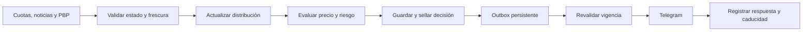

# NBA 2026-27: investigación, modelos y plan experimental

Fecha de revisión: 3 de octubre de 2026. Proyecto: QuantFut.

**Orden de implementación vigente:** [plan maestro por fases y auditoría](nba_plan_fases_auditable.md). Este documento conserva la investigación; la secuencia F0–F9, el MVP y el registro de puertas se consolidan en el plan maestro.

Actualizado con los dos archivos aportados por el usuario, ambos llamados *Texto pegado.txt*. Las secciones 17–21 revisan el primero; las secciones 22–26 contrastan el segundo y precisan cómo reducir y medir incertidumbre. El programa contiene **27 experimentos propuestos (E0–E26)**; todavía no son resultados ejecutados.

**Propuesta:** incorporar NBA como una línea experimental independiente, empezando por props prepartido de rebotes, asistencias y puntos; investigar totales en descansos con un motor por posesiones y rotaciones. La entrega prevista es una alerta inmediata por Telegram, por indicación del usuario en esta conversación. El documento define el trabajo; todavía no hay un módulo NBA implementado ni evidencia propia de rentabilidad.

**Aislamiento recomendado tras la nueva consulta del usuario:** aplicación NBA en `apps/nba/`, con dependencias, despliegue, Postgres/Redis, configuración, artefactos y Telegram propios. Los componentes de fútbol son referencia de diseño, no dependencias de runtime. [Especificación y criterios de aceptación](nba_arquitectura_aislada.md). Pendiente de implementación.

**Prioridad operativa actual:** los 27 experimentos son backlog, no requisitos para el inicio de temporada. El MVP conserva datos/PIT, minutos y tasas, calibración básica, precio aprovechable y entrega válida; estudia noticias tras disponer del núcleo. [Revisión de límites, latencia y capacidad comercial](nba_mvp_ejecucion_y_capacidad.md), resumida en la sección 27.

La temporada regular comienza el **20 de octubre de 2026**. [Calendario oficial NBA](https://www.nba.com/news/2026-27-nba-regular-season-schedule).

## 1. Qué sabemos y qué debemos comprobar

Separar tres preguntas:

1. ¿Podemos predecir la distribución de una estadística mejor que una media móvil?
2. ¿Esa información mejora el precio disponible en las casas accesibles?
3. ¿La ventaja sigue existiendo cuando el cliente recibe Telegram y apuesta?

La primera no implica la segunda ni la tercera. Una tesis doctoral sobre baloncesto puede respaldar una técnica sin demostrar una estrategia de apuestas rentable.

**No encontré evidencia pública suficiente para aceptar que las casas actuales calculen props principalmente con medias móviles simples, o que dividan los totales de cuartos de manera fija al 25%.** Esas afirmaciones se tratarán como hipótesis a contrastar. Los modelos internos de las casas no se conocen por observar unas cuantas líneas.

También conviene distinguir alta frecuencia de actualización de alta frecuencia de ejecución. Podemos recalcular ante una noticia, sustitución o cambio de cuota; para competir al segundo hacen falta datos, precios y ejecución que permitan esa velocidad. Telegram reduce el retraso de distribución, pero no elimina el del proveedor, la red o la persona.

## 2. Evidencia académica y alcance real

Esta es una revisión dirigida de fuentes primarias, no una revisión sistemática exhaustiva. Los años corresponden a los trabajos, no a la fecha en que el buscador indexó sus páginas. Los resultados antiguos deben replicarse con mercados recientes.

| Trabajo y nivel | Qué aporta | Qué no demuestra / limitación |
|---|---|---|
| **Daniel Cervone, Harvard, 2015, doctorado en Estadística**, *Inference and Prediction Problems for Spatial and Spatiotemporal Data*, cap. 2 | Modela una posesión mediante procesos estocásticos a distintas resoluciones y modelos jerárquicos con tracking a 25 Hz. Base matemática para valorar el estado del juego. | No es un backtest de props. Requiere coordenadas que no forman parte de nuestro conjunto de datos actual. Texto completo consultado. [Tesis](https://hea-www.harvard.edu/AstroStat/etc/thesis_Dan_Cervone_2015-Harvard.pdf). |
| **Cervone, D'Amour, Bornn y Goldsberry, artículo JASA, 2016**, *A Multiresolution Stochastic Process Model for Predicting Basketball Possession Outcomes* | Formaliza el valor esperado de posesión y comparte información entre jugadores y zonas. | Predecir valor de posesión no prueba ventaja económica contra una casa. [Manuscrito de los autores](https://arxiv.org/abs/1408.0777). |
| **Li-Hsuan Huang, UC Merced, 2018, doctorado en Matemáticas Aplicadas**, *Markov Chain Models and Data Science Applications*, caps. 2–3 | Cadenas de Markov en tiempo continuo para cambios de quinteto y modelos de anotación. Identifica problemas de estados absorbentes por quintetos escasos. | Es una base para minutos y rotaciones, no prueba de rentabilidad en cuartos. Texto completo consultado. [Tesis](https://escholarship.org/content/qt6ch8z986/qt6ch8z986_noSplash_03d0c9a86569ba32786e8fa0de1007fd.pdf?t=pfyxts). |
| **Bhat, Huang y Rodriguez**, *Learning Stochastic Models for Basketball Substitutions from Play-by-Play Data* | Construye un simulador desde sustituciones y tasas de plus-minus; compara técnicas de regresión. | Predecir series de playoffs no equivale a valorar props o cuotas de cuartos. Texto completo consultado. [Artículo](https://ceur-ws.org/Vol-1970/paper-08.pdf). |
| **Suraj Keshri, Columbia, 2019, doctorado**, *Essays in Basketball Analytics* | Modelos espaciales y gráficos probabilísticos que incorporan identidad de jugadores y quintetos. | Necesita datos más ricos; no garantiza ventaja de apuestas. Portada y resumen indexados consultados; acceso directo bloqueado, sin auditoría integral del texto. [Registro institucional](https://academiccommons.columbia.edu/doi/10.7916/d8-1ghx-zy51). |
| **Enrique M. Alameda-Basora, Iowa State, 2019, maestría en Ingeniería Industrial**, *A Dynamic Bayesian Network to Predict the Total Points Scored in National Basketball Association Games* | Actualización de probabilidades del total del partido al finalizar Q1, Q2 y Q3. El resumen reporta beneficios superiores al 10% y 6% para dos estrategias en el comienzo de 2018-19. | Es el antecedente más directo encontrado para totales en vivo, pero esos porcentajes no son una expectativa para 2026. Solo portada/resumen indexados verificados: falta auditar muestra, cuotas ejecutables, selección y costes. [Tesis](https://www.imse.iastate.edu/files/2019/07/Alameda-BasoraEnrique-thesis.pdf). |
| **André Cardoso Dias, ISCTE, 2016, maestría en Economía**, *Live Betting Markets Efficiency: the NBA case* | Compara precios en vivo y probabilidades logísticas entrenadas con temporadas 2007-08 a 2014-15. Encuentra discrepancias en cuatro partidos de Finales. | Cuatro partidos no establecen persistencia, causalidad ni beneficio neto ejecutable. Resumen y grado verificados en el registro, sin auditoría del PDF. [Registro y resumen](https://repositorio.iscte-iul.pt/entities/publication/12a7a022-2087-44cb-bac7-82724ff1bd21/full). |
| **Paul, Weinbach y Wilson, 2004**, *Efficient markets, fair bets, and profitability in NBA totals 1995–96 to 2001–02* | Examina eficiencia de totales: ciertos patrones no se traducen en rentabilidad estadísticamente demostrada tras el margen. | No evalúa los mercados actuales ni demuestra que un modelo de rotaciones no pueda aportar información. Abstract consultado. [Artículo](https://www.sciencedirect.com/science/article/pii/S1062976903000334). |
| **Player absence and betting lines in the NBA, Finance Research Letters, 2015** | En datos 1996-97 a 2004-05, documenta sesgos de apertura asociados con ausencias que se corrigen mayoritariamente al cierre. | Es evidencia sobre spreads del partido, no sobre props actuales; identificar una lesión no basta si el precio ya se ajustó. Abstract e introducción indexados consultados. [Artículo](https://www.sciencedirect.com/science/article/pii/S1544612315000227). |
| **Benjamin Wornow, Claremont McKenna, 2026, tesis de licenciatura**, *Betting on Performance* | Vincula líneas de cierre FanDuel y resultados individuales de 178 jugadores entre 2022 y 2025; estudia legalización y desviación respecto a props. | No es doctorado ni estrategia rentable: la desviación absoluta no identifica una dirección de apuesta. Texto restringido; solo resumen consultado. [Tesis y abstract](https://scholarship.claremont.edu/cmc_theses/4171/). |
| **Nikhil Jain, Harvard, 2026, tesis de licenciatura**, *Optimal Market Making in Prediction Markets* | Estudia eventos de mercado, ejecución y selección adversa en NBA en vivo en Kalshi. | Market making en un exchange difiere de apostar en sportsbook y distribuir picks por Telegram. No trasladar resultados de ejecución. Registro/resumen consultados. [Tesis](https://dash.harvard.edu/entities/publication/8600d0df-2b18-41ac-b75c-5fc15c2495fa). |

La evidencia encontrada respalda estudiar **posesiones, minutos, rotaciones y asimilación de noticias**. La evidencia directa de beneficio por apuestas es más limitada, antigua y heterogénea. No permite una clasificación académicamente demostrada de los mejores props de 2026.

## 3. Mercados: orden propuesto para experimentar

El orden siguiente es una **inferencia de diseño**, considerando datos requeridos, funcionamiento del proyecto y posibilidad de ejecución. No es un ranking de ROI publicado.

| Prioridad | Mercado | Hipótesis medible | Principal dificultad |
|---|---|---|---|
| 1 | **Rebotes y asistencias prepartido**, por separado | Una redistribución de minutos y rol mejora la distribución del jugador y anticipa parte del ajuste de cuotas. | Disponibilidad de oportunidades, nuevos quintetos, conversión de compañeros y ajuste rápido de las casas. |
| 1 | **Puntos prepartido**, brazo paralelo | Minutos, uso, volumen y selección de tiro aportan información incremental sobre media móvil y mercado contemporáneo. | Variabilidad de tiro; una media correcta puede tener colas mal estimadas. |
| 2 | **Total del partido en vivo al descanso o entre cuartos** | Posesiones observadas, quintetos y minutos restantes mejoran una actualización lineal del total. | Sincronizar marcador y cuota; suspensiones. Tiene antecedente académico directo en Alameda-Basora. |
| 2 | **Total y spread de primera mitad / Q1** | Perfiles de titulares y entrenador explican diferencias frente a un reparto proporcional del total. | Una táctica predictiva puede estar ya incorporada en la línea. No se verificó rentabilidad específica contemporánea. |
| 3 | **Segunda mitad y Q3 en vivo** | Faltas, rotación prevista y volumen de posesiones corrigen precios al reinicio. | Necesita reconstrucción de quintetos y estado fiable en vivo. |
| Control | **Moneyline, spread y total del partido prepartido** | Medir cuánto añade nuestro modelo a mercados amplios; comparar casas. | El mercado es un baseline exigente. La literatura aporta más pruebas de eficiencia que de ventaja persistente. |
| Posterior | Triples, PRA, props por cuarto, líneas alternativas | Extender una distribución conjunta ya calibrada. | Menor cobertura, más pruebas múltiples y mayor dependencia. |
| Posterior | Robos, tapones, primer anotador, combinadas | Solo si aparece evidencia propia y datos suficientes. | Eventos escasos, colas y correlaciones difíciles; el margen y límites deben medirse. |

No priorizar automáticamente al suplente que hereda una lesión: puede heredar minutos sin heredar uso, rebotes o asistencias. No limitarse a estrellas: evaluar estratos de rol, pero exigir muestra y encogimiento para suplentes.

## 4. Diagnóstico del proyecto existente

Revisión local de arquitectura, esquema, ingesta, evaluación, selección, publicación y configuración. No se consultó la base de producción ni se verificó cobertura NBA con llamadas de pago.

| Componente existente | Referencia de diseño | Requisito NBA independiente |
|---|---|---|
| `db/001_schema.sql`, `qf/db.py` | Postgres, auditoría e inmutabilidad | `matches` contiene goles/xG; `predictions` exige lambdas y rho. Crear entidades NBA sin convertir puntos en goles. |
| `qf/ingest/odds_worker.py` | HTTP, control de ventanas, timestamps | Solo reconoce `h2h/totals/spreads`; no identifica jugador ni periodo. Su `post_xi` depende de dos XI de fútbol. |
| `db/035_estadisticas_jugador.sql` | Experiencia de captura por jugador | Esquema de fútbol y IDs del proveedor. NBA requiere identidad propia, cambios de equipo y versiones de estadísticas. |
| `db/038_latencia_casas.sql`, `qf/ingest/rafagas.py` | Captura con presupuesto y timestamp del proveedor | Tablas y selecciones enfocadas al 1X2; no cubren contratos NBA, jugadores o periodos. |
| `qf/eval/latencia.py` | Duración de ofertas, censura y tiempo de reacción | La vara actual es 60 minutos. NBA/Telegram necesita curvas a segundos/minutos y distinguir timestamp del mercado de cambio individual. |
| `qf/model/kalman.py`, `devig.py`, `meta.py`, `residual.py` | Ideas de estado dinámico, margen, combinación y residuo | Implementación NBA sin imports de `qf`; compartir una utilidad pura solo tras extraerla, probarla y fijar su versión por aplicación. Los objetivos futbolísticos no se trasladan directamente. |
| `qf/model/features.py`, `qf/ingest/game_state.py` | Construcción secuencial y validación del marcador | Forma de fútbol, reloj de 90 minutos y descarte de prórroga no corresponden a NBA. |
| `qf/publish/picks.py`, `shadow_sharp.py` | Sombra, trazabilidad, cuotas mínimas y riesgo | Selección 1X2, persistencias estimadas en fútbol y máximo un pick por partido. Reestimar todo para NBA. |
| `qf/model/promotion.py` | Separar activación interna de autorización comercial | La puerta exige 300 ofertas y 3 ligas. NBA es una competición; necesita política propia por mercados y bloques temporales. No alterar la puerta de fútbol. |
| `qf/publish/daily.py`, `scripts/crontab` | Sellar antes de publicar | El proceso diario y cron de minutos no sirven para detectar/enviar inmediatamente en NBA en vivo. |
| `qf/publish/telegram.py` | Transporte HTTP y escape HTML | Hoy publica lotes prepartido, etiquetas de fútbol y reintentos de hasta 20 s. Falta cola, caducidad, confirmación de envío y alertas NBA individuales. |
| FastAPI, Redis, web y cadena de hashes | Lectura rápida, historial auditable | Namespace y contratos NBA; distinguir pronóstico, alerta enviada y apuesta confirmada. |

El README registra que el modelo de fútbol pierde contra el mercado, incluso temprano. Es un resultado local documentado, no reejecutado aquí. La nueva investigación debe demostrar información incremental sin asumir que cambiar de distribución o deporte produce ventaja.

La indicación nueva del usuario autoriza **planificar picks NBA por Telegram** y reemplaza, para esta ampliación, la restricción anterior de vender solo por web. No implica activar hoy la publicación general de fútbol ni usar el chat de alertas operativas como canal de clientes.

## 5. Datos necesarios y fuentes candidatas

| Capa | Campos mínimos | Fuente candidata y comprobación |
|---|---|---|
| Identidades y calendario | ID estable de jugador/equipo/partido, competición, temporada, localía, fecha UTC, sede, tipo de partido | NBA y un proveedor de calendario. Verificar temporada y cambios de equipo mediante registros con vigencia. |
| Box score jugador | Minutos, titularidad, PTS/REB/AST, OREB/DREB, FGA/FGM, 2PA/2PM, 3PA/3PM, FTA/FTM, pérdidas y faltas | NBA Stats; `nba_api` es un cliente comunitario, no un SLA oficial. Probar endpoints actuales antes de depender de ellos. [Repositorio](https://github.com/swar/nba_api). |
| Play-by-play | Orden de acción, periodo, reloj, marcador, tiros, rebotes, faltas, sustituciones, revisiones | NBA y proveedor en vivo. `pbpstats` puede ayudar a reconstruir posesiones/quintetos y documenta correcciones de eventos. Auditar contra box score. [Repositorio](https://github.com/dblackrun/pbpstats). |
| Quintetos y stints | Cinco jugadores por lado, inicio/fin, posesiones, puntos, duración | Derivar de PBP validado; tratar sustituciones entre periodos y eventos ausentes. No inventar quintetos cuando no se pueden reconstruir. |
| Lesiones y disponibilidad | Estado, motivo, versión, publicación/primera observación, fuente, límite de minutos confirmado si existe | Reportes oficiales NBA y fuente con histórico de noticias. El enlace 2026-27 no pudo verificarse; resolver el índice oficial al comenzar la captura. No sustituirlo por un reporte 2025-26. |
| Oportunidades, si hay cobertura | Potential assists, rebound chances, toques, posesión individual, distancia/zonas de tiro, emparejamientos | Estadísticas agregadas de tracking como enriquecimiento, con cobertura y antigüedad medidas. El glosario oficial define esas métricas. [NBA Stats](https://www.nba.com/stats/help/glossary?hidenav=true). |
| Contexto | Descanso, back-to-back, viaje, cambio horario, entrenador, distribución de rol, historial reciente | Derivar de calendario y datos conocidos al corte; efectos estimados solo en entrenamiento. |
| Cuotas y contrato | Casa, mercado, jugador, periodo, línea, lado, precio decimal, actualización y recepción, estado abierto/suspendido, reglas de liquidación | The Odds API ya existe en el proyecto; auditar cobertura NBA por casa/mercado. Fuente profesional si el piloto requiere menor latencia. |
| Ejecución/entrega | Decisión, sellado, envío, respuesta Telegram, expiración; cuota aceptada/hora si el cliente la confirma | Registros propios. Una respuesta de Telegram no prueba lectura ni apuesta. |

**Tracking agregado no equivale a coordenadas continuas de los diez jugadores y del balón.** Sin estas últimas no se puede reproducir íntegramente EPV de Cervone. Un dato de defensive matchup tampoco establece quién defenderá al jugador durante todo el partido: cambios y ayudas exigen tratarlo con incertidumbre.

Histórico propuesto: box scores y PBP desde 2021-22 hasta 2025-26, sujeto a cobertura. Para cuotas, noticias y tracking, utilizar únicamente las temporadas con registros verificables; no asumir cinco años completos de todo.

### Auditoría previa a elegir proveedor

Inventariar por mercado y casa accesible a los clientes: proporción de jugadores cubiertos, pares over/under en la misma línea, cierres recuperables, revisiones, timestamps, retraso observado y reglas. Las casas de la lista de fútbol son candidatas, no cobertura NBA comprobada. No asumir que Pinnacle publica o lidera todos los props. Consenso de casas que copian el mismo feed tampoco constituye varias fuentes independientes.

The Odds API documenta `basketball_nba`, mercados por jugador/periodo mediante cuotas por evento, y `description` para el jugador. El catálogo incluye `player_points`, `player_rebounds`, `player_assists`, `totals_q1` y `totals_h1`; presencia en catálogo no garantiza oferta en cada casa. [Guía](https://the-odds-api.com/liveapi/guides/v4/) y [catálogo](https://the-odds-api.com/sports-odds-data/betting-markets.html).

## 6. Captura y presupuesto de frecuencia

El proveedor documenta refrescos de **60 s para props/periodos**, y 40 s en vivo para mercados principales. Consultar más rápido no crea observaciones nuevas. [Intervalos](https://the-odds-api.com/sports-odds-data/update-intervals.html).

Sus históricos adicionales empiezan después del 3-may-2023, con snapshots a cinco minutos y coste 10 veces el de consultas actuales. Para cuotas por evento, el coste depende de mercados devueltos y regiones; agrupar hasta diez casas equivale a una región. Son reglas publicadas, a contrastar con cabeceras de consumo. [Documentación de cuotas e históricos](https://the-odds-api.com/liveapi/guides/v4/).

Los siguientes números son **cálculos de planificación**, no un gasto autorizado ni una cotización. Supuestos: 30 días, mercados disponibles en todas las llamadas y una región equivalente.

| Piloto | Cálculo | Créditos estimados/mes |
|---|---|---:|
| Capturas selectivas: 3 partidos/día, 6 cortes, 3 props | 3 × 6 × 3 × 30 | 1.620 |
| Añadir dos mercados de periodo a esos cortes | 3 × 6 × 2 × 30 | +1.080 |
| 3 partidos/día, 90 min, cada 5 min, 3 props | 3 × 18 × 3 × 30 | 4.860 |
| Los mismos, cada 60 s | 3 × 90 × 3 × 30 | 24.300 |
| 8 partidos/día, 120 min, cada 60 s, 3 props | 8 × 120 × 3 × 30 | 86.400 |
| Histórico de 300 partidos, 2 cortes, 3 props | 300 × 2 × 3 × 10 | 18.000, una vez |

Añadir otra región equivalente duplica esos casos. Las llamadas auxiliares y reintentos pueden aumentar el consumo. La captura principal de NBA puede agrupar partidos; estos escenarios calculan props/periodos **por evento**.

Recomendación inicial: piloto selectivo de 2.700 créditos como máximo teórico para cinco mercados a seis cortes, con un límite NBA independiente todavía por definir. El proyecto ya reserva 3.000 créditos mensuales a ráfagas de fútbol; no reasignarlos ni ampliar gasto automáticamente. Para alertas tras noticias, reemplazar parte de los cortes por ráfagas de 60 s solo en eventos prioritarios, dentro del mismo tope. Contabilizar `x-requests-last`, reservas y reinicio del periodo de facturación real.

Si la investigación justifica feeds de menor latencia, Sportradar documenta push de eventos y reloj para clientes Realtime. Su documentación no es una promesa de latencia para nuestro servidor ni asegura el mismo feed de cuotas. Solicitar prueba y medir ambos. [Push NBA](https://developer.sportradar.com/basketball/docs/nba-ig-push).

## 7. Almacenamiento point-in-time y contratos

Propuesta de tablas separadas, todavía no migraciones:

- `nba_games`, `nba_players`, `nba_roster_history`, `nba_player_aliases`.
- `nba_boxscore_versions`, `nba_pbp_versions`, `nba_stints`.
- `nba_availability_snapshots`, `nba_rotation_projections`.
- `nba_market_contracts`, `nba_odds_snapshots`, `nba_capture_log`.
- `nba_features_pit`, `nba_predictions`, `nba_shadow_decisions`.
- `nba_alerts`, `nba_delivery_attempts`, `nba_settlement_versions`.

Un contrato distingue: partido, jugador si aplica, estadística, periodo, línea, lado, inclusión de prórroga, condición de participación y versión de reglas de la casa. Usar identificadores de proveedor con namespace; una coincidencia por nombre nunca debe sustituir identidad verificada.

Cada observación conserva `event_at`, `source_published_at` cuando exista, `first_received_at`, `recorded_at`, versión y hash del payload. La consulta as-of se rige por cuándo el sistema recibió la información, no por una publicación anterior descubierta después. Conservar revisiones de resultados, lesiones y PBP sin reescribir el dato anterior.

En vivo, `as_of` puede ser posterior al inicio: el trigger de features de fútbol lo rechazaría. El guard NBA debe exigir que cada dato usado se recibió antes del corte de decisión y registrar periodo/reloj/acción del estado. El modelo debe estar entrenado antes de esa decisión.

`last_update` a nivel mercado no prueba el segundo exacto en que cambió un prop individual ni reconstruye cambios intermedios perdidos. Con polling, cambios y supervivencia están observados en intervalos: conservar última observación anterior y primera posterior. No rellenar retrospectivamente desde ese timestamp como si el dato ya hubiese sido recibido.

Invariantes: cinco jugadores en cancha por lado cuando el estado sea verificable; 240 minutos-equipo en regulación y 25 adicionales por prórroga; marcador final y sumas de periodos compatibles; puntos = 2·2PM + 3·3PM + FTM. Distinguir rebotes de equipo de rebotes de jugadores y reconciliar las revisiones oficiales.

## 8. Modelo de props: exposición, oportunidades y conversión

### 8.1 Minutos y disponibilidad

No usar los minutos reales del partido como feature. Construir una distribución de minutos por jugador y escenarios: activo/ausente, titular/suplente, limitación, partido competitivo, paliza, problemas de faltas y lesión durante el juego.

Una primera implementación puede ser una mezcla jerárquica con efectos de jugador/rol/entrenador y regresión de cuantiles. Una segunda modelará entrada/salida con riesgos de sustitución que dependen del periodo, tiempo continuo en cancha, faltas y diferencia de puntos. Una formulación semi-Markov permite duraciones diferentes de una exponencial fija.

Compartir información por rol y encoger interacciones de quintetos escasos. Simular rotaciones completas para garantizar coherencia de minutos del equipo, en lugar de proyectar doce jugadores de manera independiente. Huang respalda la utilidad de modelar estas transiciones; las covariables propuestas aquí son nuestro diseño experimental.

### 8.2 Ritmo y producción

Como aproximación inicial, si N son las posesiones del equipo en 48 minutos y M_i los minutos del jugador:

```text
exposición_i ≈ N · M_i / 48
log(r_i,k,t) = efecto_jugador + efecto_rol + β_k · contexto_t + estado_i,k,t
estado_i,k,t = estado_i,k,t-1 + ruido_t
μ_i,k = exposición_i · r_i,k,t
```

La igualdad de exposición es aproximada: ciertos quintetos juegan a distinto ritmo. El simulador por stints sustituirá esa aproximación cuando tengamos datos suficientes. Estimar conjuntamente efectos ofensivos y defensivos con encogimiento, evitando sumar mecánicamente el pace de los equipos.

Para asistencias y rebotes, comparar Poisson con binomial negativa:

```text
Y_i,k | contexto, minutos ~ NegBin(μ_i,k, κ_k)
Var(Y | contexto, minutos) = μ + μ² / κ
```

La binomial negativa es candidata, no una mejora garantizada. La variación de minutos ya induce sobredispersión marginal; verificar si también existe dentro de cada escenario. Los DNP y reglas de void se modelan aparte, sin entrenarlos como ceros deportivos indiscriminadamente.

Si hay oportunidades fiables:

- Rebotes: tiros fallados elegibles mientras juega, con asignación entre compañeros, rivales y rebote de equipo; ajustar OREB/DREB y zonas.
- Asistencias: potential assists o creación estimada y conversión de los compañeros. La tasa histórica simple no distingue cambios de compañero.
- Puntos: volumen de 2PA, 3PA y FTA, y probabilidades de acierto con encogimiento.

Para puntos, una estructura interpretable es:

```text
PTS = 2·2PM + 3·3PM + FTM
2PM | 2PA ~ Binomial(2PA, p2), análogamente para 3PM y FTM
```

Considerar beta-binomial si la variabilidad condicional lo requiere. Simular oportunidades de forma coherente con posesiones, faltas y tiros compartidos; independientes solo como baseline. Una ausencia redistribuye minutos y oportunidades y puede alterar la eficiencia: no asignar automáticamente todo el uso del ausente al sustituto.

### 8.3 Precio a partir de una distribución completa

Integrar disponibilidad, minutos, ritmo, rol y parámetros; no sustituirlos todos por su media:

```text
P(Y > L | información_t) = integral P(Y > L | escenario, parámetros)
                         · P(escenario, parámetros | información_t)
```

Guardar p_win, p_loss y p_push para cada contrato. Si la línea es 7,5, el over gana desde 8; si es 8, existe push al obtener 8, según reglas. Incluir prórroga o exclusión según contrato y contemplar void por participación.

La distribución conjunta comparte minutos, ritmo y eventos de tiro: PRA no se calcula sumando tres normales independientes. Tampoco multiplicar probabilidades individuales para combinadas.

Control numérico: 10.000 simulaciones con probabilidad 0,5 tienen error Monte Carlo de aproximadamente 0,5 puntos porcentuales de desviación típica. Para ventajas pequeñas usar cálculos analíticos, sumas discretas o simulación adaptativa con error reportado. No publicar una discrepancia menor que el propio error numérico.

## 9. Cuartos, mitades y actualización en vivo

Modelar posesiones y puntos por posesión; una posesión puede dar varios puntos y contener rebote ofensivo. No tratar cada punto como una llegada Poisson independiente.

```text
puntos_equipo,q = suma_{j=1..N_q} puntos_de_posesión_j
E[puntos_equipo,q] ≈ E[N_q] · eficiencia_q
```

La segunda relación es una aproximación; ritmo y eficiencia pueden depender del mismo estado. El simulador debe recoger esa dependencia.

Estado mínimo: periodo, reloj, marcador, posesión cuando sea fiable, quintetos, faltas individuales/de equipo, minutos acumulados, descansos, tiempos muertos observados y calidad/frescura del feed. Condicionar rotaciones al entrenador con encogimiento. Q4 necesita faltas intencionales, sustituciones por paliza y prórroga.

En vivo, mantener un estado bayesiano de ritmo/eficiencia y actualizar con posesiones completas. Usar filtro de partículas cuando el estado incluya escenarios no gaussianos; Kalman sobre variables latentes aproximadamente gaussianas puede ser un baseline. Evitar reentrenar un modelo pesado cada vez que llega una acción.

Para un total live, proyectar **puntos ya anotados + distribución de puntos restantes**. Para una prop live, estadística acumulada + oportunidades restantes del jugador, condicionadas a su estado. Verificar si la casa cotiza resultado final o solo tramo restante.

Experimento de cuartos: comparar (A) 25% del total, (B) proporciones históricas encogidas por equipo/entrenador, (C) rotaciones y posesiones, y (D) línea del mercado al mismo instante. Un buen modelo debe mejorar D o identificar ofertas disponibles con valor; vencer A por sí solo no basta.

## 10. Modelos modernos que sí conviene comparar

| Familia | Uso propuesto | Condición para avanzar |
|---|---|---|
| Bayes jerárquico y estado dinámico | Minutos, tasas por rol y adaptación a cambios | Distribución calibrada; efectos identificables con nuestra muestra. |
| Gradient boosting con pérdidas de distribución o cuantiles | Challenger de minutos y producción con interacciones | Comparación temporal sobre las mismas filas; las cuantiles aisladas no dan automáticamente todas las probabilidades. |
| NGBoost / boosting distribucional | Estimar parámetros de distribución | Elegir soporte compatible con conteos y comprobar colas; no asumir implementación NB incorporada. [Duan et al., ICML 2020](https://proceedings.mlr.press/v119/duan20a.html). |
| Calibración y combinación con mercado | Corregir probabilidades o incorporar residuo informativo | Ajuste solo con entrenamiento/validación; permitir que el peso del modelo termine en cero. |
| Conformal adaptativo | Auditar cobertura de intervalos bajo cambios de rol | Cobertura temporal no equivale a p(over) calibrada ni a garantía condicional para cada jugador. [Gibbs y Candès, 2021](https://arxiv.org/abs/2106.00170). |
| Pérdida orientada al mercado / decorrelación | Challenger posterior para buscar sesgos incrementales | Sin premiar discrepancia arbitraria. El proyecto ya investiga esto en fútbol; NBA requiere una prueba nueva. [Hubáček y Šír](https://arxiv.org/abs/2010.12508). |
| Procesos de eventos de cuotas y supervivencia | Duración de ofertas y reacción de casas | Suficiente historia de cambios; timestamps adecuados. Polling de cinco minutos no identifica una dinámica al segundo. |
| Transformers / grafos / EPV con tracking | Etapa futura si los datos lo justifican | Ganancia medible sobre modelos simples y coste/latencia aceptables; no requisito de primera versión. |

Un challenger práctico usa el mercado contemporáneo como offset:

```text
logit(p_over,t) = logit(p_mercado,t) + g(features conocidas al corte t)
```

Para líneas con push, separar masa de empate de probabilidad condicionada a decisión. Estimar g con pérdida probabilística y regularización; compararlo con g=0. El residuo solo sirve si añade valor fuera de muestra. No usar cierre futuro como feature.

## 11. Valor económico, riesgo y benchmark

Para cuota decimal o y contrato activo, sin void:

```text
EV por unidad = p_win·(o−1) − p_loss = o·p_win + p_push − 1
cuota mínima para EV ≥ τ = (1 − p_push + τ) / p_win
```

Ejemplo exclusivamente ilustrativo: p_win=0,56, sin push, cuota 1,91 ⇒ EV=6,96%; con margen objetivo τ=2%, cuota mínima=1,8214. Una media proyectada mayor que la línea no prueba ese 56%: hace falta la distribución.

La eliminación de margen exige pares completos del mismo jugador, periodo, línea, casa y corte. Comparar métodos proporcional/power en NBA; no asumir que Shin funciona mejor porque se utiliza en fútbol. En líneas enteras, dos cuotas devigadas no identifican por sí solas la masa de push.

La referencia puede ser una casa validada o consenso calibrado con pesos entrenados; no proclamar a Pinnacle referencia universal para props. Mantener referencia contemporánea y benchmark de cierre fuera de muestra.

CLV prepartido: usar la probabilidad justa de cierre del **mismo contrato y línea**. Si el cierre mueve la línea y no hay esa línea en alternativos, declarar CLV faltante; no interpolar silenciosamente ni comparar over 8,5 con over 9,5. Informar cobertura y sesgo de esa ausencia.

En vivo, el cierre prepartido no es comparable con información nueva. Usar score probabilístico, calibración y P&L de precios aceptados; un movimiento tras la alerta puede incorporar una nueva canasta. Para medir reacción, comparar estados equivalentes o hacer un estudio de eventos que registre qué cambió. No llamar automáticamente CLV al siguiente precio live.

Primera fase: stake virtual uniforme. Después, Kelly fraccional con incertidumbre y topes, calculado con probabilidad conservadora y dependencia entre apuestas. Las persistencias, Kelly y límites de fútbol no están calibrados para NBA. Recomendación de riesgo propuesta: limitar primero por partido y jugador; variar topes solo en validación. La matriz de covarianza puede estimarse desde el simulador conjunto y contrastarse con resultados.

## 12. Telegram inmediato: arquitectura y medición

Flujo propuesto, sin modificar el pipeline de fútbol:



Worker NBA persistente dirigido por eventos o polling presupuestado; outbox durable en Postgres y Redis como coordinación/cache. Una tarea diaria no proporciona alertas inmediatas. Guardar decisión y outbox en la misma transacción, respetando la garantía de sellado antes de cualquier envío.

Preferir un canal de difusión para el piloto de la misma alerta a muchos clientes. Mensajes privados requieren considerar fan-out: Telegram documenta unos 30 envíos/s gratuitos y límites por chat. Son límites del API, no garantías de entrega al dispositivo. [FAQ oficial](https://core.telegram.org/bots/faq).

Registrar t_source, t_received, t_decision, t_sealed, t_send, t_ack y, si se informa, t_bet. Reportar p50/p95 y errores por tramo. Objetivo técnico propuesto: decisión sellada a respuesta de Telegram p95 <2 s con un canal y sin fallo de red; medirlo, no prometerlo. Frescura total depende del feed y se reporta aparte.

Cada alerta incluye partido/jugador, mercado/periodo/línea, lado, casa, cuota vista, cuota mínima, hora de observación, validez, ID y estado del partido si es live. Horas de interfaz en `America/Mexico_City`, almacenamiento UTC. Señalar stake simulado durante investigación.

Ejemplo sintético, no pick real:

```text
NBA · ALERTA EXPERIMENTAL #NBA-001
Jugador A · Rebotes · partido completo · Más de 7,5
Casa X · cuota vista 1,91 · mínima 1,83
Observada 19:42:08 CDMX · revalidar antes de apostar
Válida hasta 19:43:08 o hasta cambio de línea/estado
Stake virtual 1 u · modelo nba-props-v0
```

La validez de 60 s del ejemplo no está validada. Se estimará por mercado/casa. Filtrar datos obsoletos, líneas cambiadas, feed desincronizado y mercados retirados antes de enviar. Con fuentes que no exponen suspensiones, registrar ese límite; cotización presente no prueba ejecución.

Deduplicar por señal y contrato; reintentos solo mientras siga vigente. `sendMessage` no proporciona una garantía general de exactly-once: si se pierde una respuesta, el estado de entrega es incierto. Conservar intentos/IDs y evitar reintentos ciegos que dupliquen o envíen picks caducados. Atender 429 y `retry_after`. [Bot API](https://core.telegram.org/bots/api#responseparameters).

Una invalidación posterior se publica como evento enlazado al original; no borrar ni reescribir la recomendación histórica. El canal de clientes y el operativo tienen configuración separada. La apertura del módulo live exige una puerta propia: el formateador actual de Telegram solo contempla prepartido.

## 13. Validación temporal y experimentos preregistrados

Baselines obligatorios: media móvil simple, tasa encogida por minuto con minutos previstos, modelo de oportunidades, mercado sin margen contemporáneo y criterio de diferencia entre casas. Comparar sobre las mismas oportunidades observadas, conservando también las descartadas y motivo.

Diseño temporal: entrenar hasta una fecha, validar en el bloque siguiente y probar en el posterior; repetir walk-forward. Mantener todos los jugadores/cuotas de un mismo partido en el mismo bloque. Ajustar hiperparámetros, calibradores, pesos, umbral y stake exclusivamente antes del bloque de prueba. No seleccionar mercados viendo el resultado final.

El histórico de estadísticas descargado hoy sirve para investigación retrospectiva, pero no demuestra qué revisiones/noticias estaban disponibles entonces. Separar backtests deportivos de backtests con noticias point-in-time y de captura prospectiva real. Una cuota histórica con timestamp verificable se puede usar al corte indicado; no inventar timestamps del resto de datos.

| Experimento | Comparación que aísla el efecto | Resultado principal |
|---|---|---|
| E0: cobertura y entrega | Mercado × casa × corte, antes de elegir señales | Pares completos, frescura, cierres, consumo y latencia Telegram. |
| E1: minutos | Media reciente vs modelo de minutos/rotación | Error y cobertura de minutos; log-score/CRPS de props resultante. |
| E2: lesiones/rol | E1 con y sin noticias capturadas oportunamente | Ganancia probabilística y EV después de retraso. No atribuir causalidad por una asociación. |
| E3: oportunidades | E2 con y sin oportunidades de rebote/asistencia/tiro | Información incremental tras controlar minutos y mercado. |
| E4: periodos | Reparto fijo vs proporciones vs rotaciones vs mercado | Calibración, score y retorno al precio observable. |
| E5: ejecución Telegram | Misma señal, precio a +0/+15/+30/+60/+120 s de envío y +5 min | Supervivencia de ventaja, disponibilidad y retorno; separar retraso del feed. |
| E6: modelo moderno | Jerárquico vs boosting distribucional vs combinación/residuo | Mejora fuera de muestra con coste/tiempo medidos. |

E5 es replay de escenarios si no hay apuestas confirmadas. Si solo hay snapshots cada 60 s, no afirmar que conocemos el precio a +15 s: usar primera observación posterior, límites de incertidumbre y reportar resolución. Si la señal cambia de estado por una acción, revalidar contrato/modelo.

Métricas: log-score de distribución, CRPS, cobertura 50/80/95%, Brier/log-loss de over/under, calibración por rol/línea/mercado y precisión de minutos. Económicas: EV contra benchmark válido, ROI de precios aceptados o simulados claramente identificados, drawdown, número de oportunidades, cobertura de cierre y tasa de ofertas aprovechables.

Bootstrap agrupado por partido y bloques de días/semanas; sensibilidad a correlación longitudinal por jugador. Mil snapshots o veinte props de un partido no son mil o veinte observaciones independientes. Registrar el número total de variantes; corregir pruebas múltiples o mantener una prueba final intacta. Si se revisa a diario, fijar fechas de lectura o emplear inferencia secuencial válida.

## 14. Puertas propuestas para NBA

Son criterios nuevos para preregistrar, no puertas ya aprobadas ni cumplidas:

1. Datos: identidad correcta, reglas de liquidación, estado/frescura aceptables y auditoría de faltantes. Las señales sin datos indispensables se abstienen.
2. Modelo: mejora de métricas probabilísticas relevantes sobre baseline simple, calibración de las colas usadas y comparación explícita con mercado. Un criterio de diferencia entre casas se evalúa aparte y no necesita fingir superioridad del modelo deportivo.
3. Muestra prospectiva: piso propuesto de 300 **partidos distintos** con oportunidades liquidadas, al menos 60 días y tres bloques cronológicos. Segmentar los mercados; una muestra conjunta no certifica cada mercado ni cada casa. El tamaño definitivo depende de varianza y potencia, y puede ser bastante mayor.
4. Economía: para prepartido, límite inferior de IC95 del EV al cierre comparable >0 en el conjunto preregistrado, con cobertura suficiente. Para live, retorno ejecutable ajustado por costes y calibración; no sustituirlo por un falso CLV prepartido.
5. Ejecución: ventaja positiva bajo el retraso medido del cliente, no solo a t_decision. Mercado y cuota disponibles con frecuencia suficiente; sensibilidad a suspensiones, slippage y límites reales.
6. Generalización: estabilidad entre bloques, jugadores y casas cubiertas; concentración de retorno reportada. No exigir tres ligas ficticias para cumplir una regla de fútbol.

Con 300 apuestas independientes, un ROI pequeño todavía puede tener un intervalo muy amplio. Este número es un piso de investigación, no una demostración de beneficio. Publicación de NBA desactivada por defecto; generación y registro en sombra pueden arrancar antes.

## 15. Hoja de ruta y adaptación al comienzo de temporada

| Fase | Entregable concreto | Estimación de trabajo, condicionada a datos |
|---|---|---|
| A | Auditoría de proveedor/casas, reglas, IDs, gasto y transporte Telegram de prueba | 2–4 días |
| B | Esquema/ingesta NBA, archivo raw, histórico deportivo, snapshots prospectivos y validadores | 4–7 días |
| C | Baselines, minutos y distribución inicial; dashboard de cobertura/calibración | 5–10 días |
| D | Registro en sombra, alertas experimentales autorizadas, ensayo de caducidad y ejecución | 2–4 semanas de operación inicial; evidencia comercial exige más muestra |
| E | PBP en vivo, stints, filtro y totales entre periodos | 2–4 semanas adicionales si cobertura/latencia pasan el piloto |

Antes del inicio, el objetivo razonable es **capturar datos y registrar predicciones**, no declarar un sistema ganador. Pretemporada sirve para validar ingesta y entrega, pero sus minutos, plantillas y rotaciones no se mezclan con temporada regular sin indicador y tratamiento propio.

Inicio de 2026-27: usar priors de 2025-26 encogidos; aumentar incertidumbre tras traspasos, entrenador nuevo o cambio de rol; compartir información para novatos sin inventar historial NBA. Separar playoffs, temporada regular y partidos de otro contexto según la competición oficial y reglas del contrato. Detectar cambios de rol y reestimar gradualmente; no descartar arbitrariamente los primeros partidos ni dar certeza a una proyección de pretemporada.

## 16. Decisión recomendada

Construir primero **minutos + producción por posesión + valoración de cuotas**. Capturar los tres props básicos para compararlos, con rebotes/asistencias como hipótesis prioritaria y puntos como brazo paralelo. Añadir periodos selectivos para investigar rotación; incorporar totales live en descansos cuando estado y latencia sean medibles.

Entregar por Telegram desde un proceso dedicado con sellado, outbox, revalidación y caducidad. La hipótesis económica es que cierta información de minutos/rol, o una diferencia entre casas, persiste el tiempo suficiente para que el cliente tome la cuota. Si no persiste, el experimento debe decirlo aunque las predicciones deportivas sean buenas.

No se implementó código NBA, no se activó Telegram de clientes, no se gastaron créditos en proveedores ni se modificaron puertas, triggers o modelos de fútbol. La revisión de sintaxis de 74 archivos Python fue satisfactoria con el runtime disponible; el arnés Bash no ejecutó sus pruebas por limitaciones del entorno Windows y no se considera validación completa. No se presentan resultados empíricos NBA propios.

## 17. Contraste del texto aportado

El archivo mezcla ideas matemáticas útiles con afirmaciones sobre mercado e industria sin referencias. El material disponible termina al iniciar el apartado de discrepancias contra sharp books; esa idea se desarrolla en las secciones 11 y 19.

| Afirmación del texto | Evaluación | Cómo incorporarla |
|---|---|---|
| Cuántico y cuantitativo son conceptos distintos | Correcto. La metodología propuesta aquí es cuantitativa clásica. | No etiquetar un filtro bayesiano o Monte Carlo como cuántico. |
| D-Wave optimiza quintetos NBA en milisegundos con ventaja práctica | No encontré un estudio NBA verificable que sostenga esa velocidad total y ventaja frente a solvers clásicos. | Benchmark opcional fuera del camino crítico; incluir formulación, transferencia, cola, embedding y postproceso. |
| VQC describe momentum NBA de forma superior | No encontré evidencia directa suficiente de superioridad para este objetivo. | Un experimento necesitaría baseline clásico equivalente, partición temporal y cómputo total. No convertirlo en dependencia. |
| Monte Carlo por posesión y Bayes jerárquico son apropiados | Sí, como técnicas respaldadas por los trabajos revisados, sin probar cuál usa cada sindicato. | Minutos/rol, transición de posesiones y distribución conjunta. |
| XGBoost/LightGBM son el estándar universal entre apostadores profesionales | Son candidatos técnicamente razonables; la afirmación industrial no quedó documentada. | Comparar con baselines y Bayes, sin preferir marca de librería por reputación. |
| Four Factors explica el 95% de las victorias | No se verificó esa cifra ni qué significa: accuracy, varianza o importancia explicativa. | Medir aporte predictivo antes del partido; métricas del propio encuentro solo entran a un modelo live tras ser observadas. |
| El 32% de uso de una estrella se redistribuye automáticamente | Cambian reparto, denominador, ritmo y eficiencia; no es una cantidad fija transferible. USG no mide creación de asistencias. | Estimar escenarios de ausencia con composición coherente; modelos diferentes para tiros, asistencias y rebotes. |
| EPM/DARKO son las métricas más precisas del mundo | Sus autores documentan metodologías útiles; no se verificó supremacía para nuestros props ni ejecución. | Baselines/enriquecimiento con acceso y versión as-of, no probabilidades de over directamente. |
| Una alta calidad de tiro garantiza regresión positiva | La expectativa futura puede superar la realización reciente; ni el próximo partido ni una apuesta al over quedan garantizados. | Separar volumen, selección de tiro, habilidad y precio; comprobar mejoras fuera de muestra. |
| `nba_api` entrega gratuitamente todo el tracking necesario | Es un cliente comunitario de endpoints; métricas agregadas no son tracking óptico completo ni servicio de baja latencia garantizado. | Auditar disponibilidad actual, historial y revisiones por endpoint. |
| Cleaning the Glass es indispensable y siempre hay que eliminar garbage time | Filtrar puede ayudar al estimar habilidad competitiva, pero excluir esos minutos del resultado de una prop completa sería incorrecto. | Separar habilidad competitiva de un régimen de minutos basura; el simulador incluye ambos cuando el contrato los cuenta. |
| Props tienen ineficiencia muy alta, Q1 media-alta y live alta | No se encontró una medición comparable que demuestre esas categorías hoy. | Ranking propio basado en cobertura, margen, ventaja, duración y precios alcanzables. |
| Una lesión tarda entre 30 segundos y 3 minutos en incorporarse | Es una hipótesis no verificada para nuestras casas y feed. Algunas cotizaciones pueden desaparecer o suspenderse. | Estudio de eventos y supervivencia; registrar recepción, cambios y faltantes, sin asignar tiempo fijo. |
| Los titulares juegan casi todo Q1 | Depende del jugador, entrenador y partido; las sustituciones deben medirse. | Curva de probabilidad de estar en cancha por minuto y periodo, no quinteto inicial fijo. |
| Tras tres partidos fallando, apostar over por regresión inevitable | Confunde reversión de una estimación extrema con compensación de resultados pasados. | No adoptar una regla de over basada solo en rachas; comparar probabilidades y cuota actual. |

**Una ilustración matemática:** con probabilidad fija e independiente de triple de 0,40, fallar los últimos cinco no cambia la probabilidad del sexto: sigue siendo 0,40. Si la habilidad es desconocida, los fallos sí actualizan la posterior y puede reducirse la estimación; si cambió el rol o la defensa, puede cambiar también la probabilidad real. Ninguno de esos casos obliga a acertar para compensar.

Tampoco conviene eliminar el box score: es necesario para objetivos, liquidación y priors. La mejora consiste en añadir exposición y contexto, no en sustituir estadísticas fiables por métricas que no sabemos obtener al corte.

## 18. Literatura adicional y qué experimento permite

| Fuente primaria | Aporte verificado | Adaptación y límite |
|---|---|---|
| **Miller, Bornn, Adams y Goldsberry, ICML 2014**, *Factorized Point Process Intensities* | Procesos espaciales de tiros y factorización no negativa para representar estilos de jugadores en pocas dimensiones. | Clusters de perfiles de tiro para compartir información; coordenadas de tiros pueden bastar para esta parte, sin tracking continuo. No prueba ROI. [Artículo y PDF](https://proceedings.mlr.press/v32/miller14.html). |
| **Franks, Miller, Bornn y Goldsberry, Annals of Applied Statistics 2015**, *Characterizing the Spatial Structure of Defensive Skill* | Combina tracking, modelos jerárquicos y procesos espaciales para caracterizar defensa. | Respalda tratar emparejamientos como inferencia compleja; no fingir reconstrucción de defensores a partir del box score. [Manuscrito](https://arxiv.org/abs/1405.0231). |
| **Josephs y Upton**, *Hypergraph Adjusted Plus-Minus*, preprint 2024 | Extiende APM a individuos, pares, tríos y quintetos; demuestra metodología con NBA 2012–2022. | Challenger de interacción entre compañeros con fuerte regularización. Estimar impacto de marcador no sustituye tasas personales de props. [Manuscrito](https://arxiv.org/abs/2403.20214). |
| **Miller y Sanjurjo, Econometrica 2018**, *Surprised by the Hot Hand Fallacy?* | Identifica sesgo de selección al medir resultados posteriores a rachas en secuencias finitas. | Diseñar pruebas de rachas con permutaciones/simulaciones apropiadas y contexto de tiro; no asumir ausencia o existencia universal de hot hand. [Artículo](https://onlinelibrary.wiley.com/doi/abs/10.3982/ECTA14943). |
| **Skinner, PLOS ONE 2012**, *The Problem of Shot Selection in Basketball* | Modelo de decisión de tiro como parada óptima dependiente de oportunidades restantes y pérdidas. | Incorporar reloj de tiro si se observa, para distinguir oportunidades tempranas/tardías. Modelo teórico simplificado, no demostración de apuesta rentable. [Artículo](https://journals.plos.org/plosone/article?id=10.1371/journal.pone.0030776). |
| **Adams y MacKay, 2007**, *Bayesian Online Changepoint Detection* | Inferencia secuencial de cambios de régimen mediante distribución del tiempo desde el último cambio. | Detectar cambio de minutos/rol y ajustar velocidad de aprendizaje. No es evidencia NBA; requiere evaluación nueva. [Manuscrito](https://arxiv.org/abs/0710.3742). |
| **Howard, Ramdas, McAuliffe y Sekhon, Annals of Statistics 2021**, *Time-uniform, Nonparametric, Nonasymptotic Confidence Sequences* | Intervalos válidos a lo largo del tiempo bajo condiciones especificadas. | Lecturas repetidas de experimentos sin elegir la primera racha favorable. Dependencia, límites del retorno y null deben definirse; no aplicar como receta sin supuestos. [Artículo de los autores](https://arxiv.org/abs/1810.08240). |
| **Eastward Jet Lag Is Associated with Impaired Performance and Game Outcome in the NBA, 2022** | Investigación observacional de viaje y rendimiento. | Feature candidata, no penalización fija universal ni prueba de ventaja contra cuotas. Texto indexado consultado; acceso completo bloqueado. [Estudio](https://pmc.ncbi.nlm.nih.gov/articles/PMC9245584/). |
| **Does Rest Breed Rust?, 2022** | Estudia decisiones DNP-Rest y rendimiento regular/postemporada. | Distinguir carga, decisión de descanso y selección de quién descansa. No asumir que cada día libre eleva el rendimiento igual. Resumen indexado consultado. [Estudio](https://pmc.ncbi.nlm.nih.gov/articles/PMC9622780/). |
| **Scaling Advantage in Approximate Optimization with Quantum Annealing, PRL 2025** | Evidencia de ventaja aproximada en clases específicas de optimización, con comparación de algoritmos. | No demuestra ventaja en quintetos, props o predicción NBA; la instancia y baseline importan. [Manuscrito](https://arxiv.org/abs/2401.07184). |

EPM combina un modelo estadístico de impacto con RAPM y priors; su sitio publica evaluación de margen del partido mediante validación aleatoria de diez folds. Es informativo, pero para nuestro objetivo se debe repetir validación temporal y comparar mercado, no tomar esa evaluación como certificación de props. [Metodología de su creador](https://dunksandthrees.com/about/epm).

DARKO documenta decaimiento diferente por estadística, filtro Kalman modificado y combinación con boosting. La idea relevante es que los minutos pueden cambiar más rápido que ciertas habilidades de tiro: no imponer la misma ventana de cinco partidos a todas las variables. [Metodología de DARKO](https://www.darko.app/about).

Cleaning the Glass confirma que filtra garbage time y tiros desesperados. Es una referencia de análisis, con acceso/condiciones por comprobar; no un requisito para empezar la captura propia. [Descripción del servicio](https://cleaningtheglass.com/).

## 19. Experimentos adicionales E7–E20

Cada experimento fija antes de la lectura: hipótesis, universo, baselines, métrica primaria, partición temporal, tamaño/fecha de lectura y criterio de abandono. No ejecutar todas las variantes y después presentar únicamente la ganadora.

| ID / prioridad | Hipótesis y comparación | Datos y criterio científico |
|---|---|---|
| **E7 / alta: reacción a noticias** | Escenarios precalculados de ausencia aportan valor entre recepción de una baja y ajuste de cuota. Comparar escenario actualizado vs congelado. | Archivo de noticia/estado y cuotas. Medir cambios en precio justo y ofertas accesibles en intervalos. Placebos de hora y noticias sin cambio de estado. Clustering por anuncio/partido; no contar cada compañero como noticia independiente. |
| **E8 / alta: minutos frente a uso** | El beneficio viene de minutos, tasa productiva o interacción de ambos. Comparar cuatro brazos: base, solo minutos, solo tasa/rol y ambos. | Proyecciones as-of y resultado. Descomponer error y score, con mismo universo. Uso no debe derivarse de estadísticas futuras. |
| **E9 / alta: garbage time** | Estimar habilidad sin palizas mejora el régimen competitivo, pero un simulador con régimen de paliza predice mejor la prop completa. | PBP/rotaciones. Comparar todos los minutos, exclusión ingenua y mezcla de regímenes. Definir garbage time solo con estado disponible en cada acción; no etiquetar pasado con margen final. Evaluar sin recortar el resultado liquidable. |
| **E10 / media: volumen vs calidad de tiro** | La señal de baja eficiencia reciente mejora cuando se distingue volumen/zonas de habilidad. | Tiros geolocalizados y contexto verificable; tracking si se usa distancia al defensor. Base de acierto con encogimiento vs perfil espacial vs calidad completa. Comparar distribución de puntos/triples y cuota contemporánea; no usar calidad calculada con resultado futuro. |
| **E11 / media: rachas y momentum** | Rachas aportan información después de controlar jugador, distancia, reloj, volumen y defensa disponible. | Secuencias de tiros; modelos sin/con rachas y estado latente. Corregir sesgo de selección y hacer simulaciones nulas con igual selección. Exigir mejora predictiva y económica separadas. |
| **E12 / alta: estructura de Q1/H1** | Rotaciones reales permiten anticipar el reparto de posesiones/anotación mejor que el 25%/50% fijo. | Curvas de minutos por entrenador y línea de periodo. Comparar contra mercado al mismo corte; efectos de entrenador encogidos y evaluados tras cambios de equipo. |
| **E13 / media: competencia por oportunidades** | Un modelo compartido explica rebotes/asistencias tras ausencias mejor que tasas personales independientes. | Quintetos, fallos elegibles, asistencias y conversiones. Distribución multinomial/Dirichlet-multinomial para asignar oportunidades cuando sea apropiado; verificar sumas, colas y covarianza. |
| **E14 / media: faltas y riesgo de salida** | Faltas y política del entrenador anticipan minutos restantes mejor que extrapolar minutos actuales. | PBP y quintetos. Riesgo de sustitución condicionado a faltas, periodo y diferencia; comparación de supervivencia y props restantes en igualdad de estado. |
| **E15 / posterior: interacción de jugadores** | Pares/tríos mejoran eficiencia de quintetos y sus oportunidades sobre RAPM aditivo. | Stints con suficiente muestra. Ridge jerárquico / hypergraph APM vs modelo aditivo. Penalización escogida en validación; reportar combinaciones nunca vistas y estabilidad. |
| **E16 / media: viaje, descanso y carga** | Carga reciente y dirección de viaje añaden señal sobre localía y descanso simples. | Calendario, sedes y minutos recientes. Ablación por componente y estadística; controlar fuerza rival y rol. Viaje inferido del calendario no prueba itinerario o sueño real. |
| **E17 / alta: liderazgo y duplicación de feeds** | Algunas casas incorporan información antes que otras y la oferta dura lo necesario tras Telegram. | Cuotas con fuentes/recepción. Comparar cambios del mismo contrato, shocks comunes y timestamps iguales; estimar duración con censura/intervalos. No atribuir causalidad o liderazgo a una correlación ni tratar casas clonadas como consenso independiente. |
| **E18 / alta: fuga y controles negativos** | El pipeline no fabrica ventajas por joins, revisión futura o selección temporal. | Placebos con etiquetas permutadas por bloques adecuados, feature de noticias retrasada, comparación de hora publicada vs recibida y modo negativo sin señal. Un ensayo aislado puede ser positivo por azar; ventaja repetida o sistemática en placebos obliga a auditar antes de confiar. |
| **E19 / alta: robustez de entrega y cuota** | La estrategia resiste fallos/retrasos realistas y sigue ofreciendo precios aprovechables. | Replay con latencia variable, duplicados, acción corregida, snapshot perdido, 429, suspensión y cambio de línea. Simulación offline, sin enviar a clientes ni apostar. Reportar alerta caducada, pérdida de oportunidad, doble envío y EV tras retraso. |
| **E20 / exploratoria: optimización clásica/cuántica** | Una formulación combinatoria aporta utilidad y algún solver mejora coste/calidad total. | Primero enumeración/ridge/QUBO o MILP clásicos offline; después simulador cuántico o hardware solo si se justifica. Misma instancia, restricciones, gap, éxito y tiempo total. Optimizar un quinteto no significa predecir el que elegirá el entrenador. |

E7 estudia noticias capturadas, no una intervención aleatoria sobre lesiones. El on/off está confundido por rival, compañeros, entrenador y estado del partido. Ajustar contexto y regularizar sirve a predicción; una conclusión causal necesita diseño e hipótesis adicionales. Una diferencia en diferencias solo sería pertinente con controles, tendencias y tratamiento adecuados; las ausencias transitorias no encajan automáticamente en adopción permanente. [Marco de Callaway y Sant'Anna](https://arxiv.org/abs/1803.09015).

Una feature de combinación puede expresarse como:

```text
eficiencia_quinteto = intercepto + Σ efecto_jugador
                   + Σ interacción_par + efecto_contexto
```

Los términos de interacción reciben penalización fuerte o priors jerárquicos. Expandir indiscriminadamente todos los quintetos es una fuente de varianza, no información nueva. Además, escoger el quinteto de mayor eficiencia estimada ignora fatiga, faltas, disponibilidad y decisiones futuras del entrenador.

Para E20, elegir cinco de doce jugadores da 792 quintetos; elegir cinco de quince da 3.003. Enumerar un conjunto así es una base clásica razonable. El problema crece al añadir rival, secuencia de rotaciones, duración y restricciones, pero ese crecimiento no demuestra necesidad o ventaja cuántica. Comparar mejoras bajo los mismos recursos y precisión; no comparar tiempo de annealing aislado con un pipeline clásico completo.

## 20. Potencia estadística y coste de buscar muchas ideas

Hay dos objetivos diferentes: detectar mejora de distribución y demostrar retorno pequeño tras margen. El segundo suele requerir bastante más muestra.

Cálculo orientativo propio, bajo apuestas independientes, stake uniforme, cuota fija 1,91 y sin push/void/costes: para ROI esperado de 3%, la tasa de acierto sería 1,03/1,91 ≈ 53,93%. La desviación típica del beneficio por apuesta es cercana a 0,95 unidades.

```text
semianchura aproximada IC95(ROI) ≈ 1,96 · 0,95 / √n
n para semianchura de 0,03 ≈ 3.900
n para prueba bilateral α=0,05 y potencia ≈80% ≈ 7.900
```

Son aproximaciones normales para planificación. No una garantía: correlación, selección, cambio de cuotas, costes, pruebas múltiples y búsqueda de estrategias pueden incrementar mucho el requisito. El piso de 300 partidos de la sección 14 no certifica ROI de 3%.

Para los 27 experimentos, agrupar familias: datos/ejecución, props, periodos, dinámica/contexto, fiabilidad y optimización. Fijar una métrica primaria por experimento; tratar las demás como secundarias. Un descubrimiento exploratorio debe confirmarse en un bloque nuevo; no promoverlo utilizando la misma temporada que motivó el cambio.

Si se desea revisar continuamente, usar lecturas programadas o una secuencia de confianza con supuestos revisados. Agrupar observaciones correlacionadas y acotar exposición diaria antes de derivar una prueba secuencial; ese método no corrige por sí solo una fuga temporal o precios imposibles.

Criterios de abandono útiles: no mejora al baseline contemporáneo, mejora solo en datos revisados, ventaja desaparece con retraso medido, cobertura insuficiente, retorno concentrado en un caso o coste de datos mayor que utilidad alcanzable. Conservar resultados negativos y variantes probadas.

## 21. Programa inicial resultante

**Primera tanda:** E0, E1, E5, E7, E8, E17, E18 y E19. Resuelven si tenemos datos correctos, minutos útiles, una noticia incremental y cuotas que sobreviven al envío. E2/E3 profundizan rol y oportunidades cuando la cobertura permita aislarlos.

**Segunda tanda:** E4, E6, E9, E12, E13 y E14. Comparan modelos, regímenes, reparto por periodos y dependencias. E10/E11/E16 requieren cobertura histórica/contextual suficiente y una prueba nueva.

**Posterior:** E15 y E20. Interacciones de alto orden y experimentos cuánticos no deben retrasar la captura ni distraer del cuello de botella de precio y ejecución.

La pieza operativa más interesante del texto es **precalcular escenarios de disponibilidad**. Preparar distribuciones para baja individual y algunos escenarios conjuntos plausibles; al recibir noticia verificada, actualizar el escenario, revalidar precio y emitir solo si continúa la ventaja. No simular todas las combinaciones posibles ni fijar minutos después de ver el resultado.

Para arrancar se necesitan acuerdos concretos sobre cobertura de casas NBA, credenciales/canal de pruebas Telegram y presupuesto de captura. Esta investigación no contrató servicios, cambió suscripciones ni publicó mensajes. El entregable es el plan científico integrado y revisable; los siguientes pasos son implementación y medición prospectiva.

## 22. Revisión del segundo texto: ciencia real y afirmaciones que exceden la evidencia

El análisis cuantitativo del deporte sí tiene literatura formal en estadística, econometría e investigación de operaciones. De ahí no se sigue que cualquier modelo complejo produzca ganancias, ni que sea una rama de física teórica por definición. Separar antecedente histórico, método publicado, evidencia deportiva y ventaja comercial reproducible.

| Afirmación aportada | Evaluación y corrección |
|---|---|
| Shannon y Thorp construyeron un dispositivo para ruleta | Antecedente real, documentado por MIT. El ejemplo incorpora mediciones físicas del sistema; no prueba que resultados NBA sean predecibles con la misma certeza. UCLA fue parte de la formación de Thorp; la trayectoria docente relevante incluye MIT, New Mexico State y UC Irvine. [MIT](https://arts.mit.edu/opportunities/giving-to-the-arts-at-mit/ed-thorp/), [archivo UCI](https://www.lib.uci.edu/sites/default/files/2021-01/Thorp-checklist.pdf). |
| Ellos publicaron Dixon–Coles en JRSS-C | La redacción mezcla autores: el artículo es de **Mark J. Dixon y Stuart G. Coles, 1997**. Corrige un producto de Poisson en cuatro marcadores: 0–0, 0–1, 1–0 y **1–1**. No confundirlo con el modelo clásico de Poisson bivariado de componente común. La ponderación temporal reduce la influencia de partidos antiguos; no afirma que la habilidad necesariamente disminuya. [Artículo original](https://rss.onlinelibrary.wiley.com/doi/10.1111/1467-9876.00065). |
| Benter 1994 prueba 120 variables bayesianas y casi mil millones de beneficio | El capítulo consultado respalda logit multinomial, calibración, evaluación fuera de muestra y combinación de probabilidades fundamentales con las del público. No encontré ahí sustento para esas cifras ni para caracterizar el modelo descrito como un estimador bayesiano. Su lección aplicable es **medir la información adicional frente al mercado**. [Capítulo original, copia del PDF](https://gwern.net/doc/statistics/decision/1994-benter.pdf). |
| EPV original usa redes neuronales y Second Spectrum a 25 Hz | La resolución de 25 Hz sí aparece; los autores agradecen los datos a **STATS LLC/NBA**. El método original usa un proceso estocástico multirresolución y modelos jerárquicos espaciotemporales; no corresponde atribuirle redes neuronales como componente central. EPV es esperanza de puntos de una posesión, no probabilidad de cobrar una prop. [Manuscrito original](https://arxiv.org/pdf/1408.0777). |
| Favorite–longshot bias es una ineficiencia universal explotable | Su dirección y presencia dependen de deporte, contrato, periodo y margen. Hay evidencia original de sesgo inverso en béisbol y de sesgo convencional en deportes universitarios. Ninguno certifica props NBA actuales. [Woodland y Woodland](https://onlinelibrary.wiley.com/doi/abs/10.1111/j.1540-6261.1994.tb04429.x), [estudio de mercados universitarios](https://www.sciencedirect.com/science/article/abs/pii/S1062976916000041). |
| MCMC actualiza habilidad con cada punto en tiempo real | Es posible diseñar algoritmos online que incluyan MCMC, pero no es una obligación ni suele justificar recalcular un posterior completo por canasta. Separar inferencia de parámetros offline de filtrado del estado online. La frecuencia de observación tampoco equivale a cambios de habilidad. [SMC y filtrado, curso del autor en Oxford](https://www.stats.ox.ac.uk/~doucet/samsi_course.html). |
| Nash + Kelly resuelve automáticamente correlaciones de diez partidos | Kelly maximiza crecimiento logarítmico bajo una distribución; Nash analiza interacción estratégica. Una cartera Kelly no requiere equilibrio de Nash. La dependencia debe estimarse: distintas fechas, fatiga o árbitros no implican una correlación económica grande entre todas las apuestas. La dependencia de props del mismo partido sí merece modelado conjunto. [Kelly con restricciones de riesgo](https://web.stanford.edu/~boyd/papers/pdf/kelly.pdf). |
| JQAS está publicada por ASA | Es revista oficial de ASA, con editor comercial De Gruyter; pertenencia y publicación son conceptos distintos. Estar en arXiv tampoco equivale a revisión por pares. [Información editorial](https://www.degruyterbrill.com/document/doi/10.1515/jqas-2021-frontmatter2/pdf). |
| Sindicatos privados tienen modelos mejores que cualquier casa | Sus sitios y ofertas laborales pueden documentar actividad, pero no auditan esa superioridad, plantilla doctoral o rentabilidad. No usar cifras privadas como benchmark científico. Starlizard describe su trabajo y SIG publica puestos de sports trading; la afirmación específica sobre una división deportiva de Jump queda sin verificar en esta revisión. [Starlizard](https://starlizard.com/), [puesto de SIG](https://careers.sig.com/global-susquehanna/jobs/10622?lang=en-us). |

La autoridad de un doctorado o una empresa es contexto. La decisión de incorporar una técnica depende de datos disponibles, comparación justa, resultado fuera de muestra y ejecución accesible.

## 23. Qué significa aumentar la certeza en este proyecto

Conviene medir cuatro cosas separadas:

1. **Variabilidad del resultado:** aun con rol y habilidad conocidos, los tiros, faltas, rebotes y decisiones producen resultados distintos. Más datos no eliminan esa variabilidad.
2. **Incertidumbre del modelo:** no conocemos exactamente habilidad, tasa, rotaciones futuras ni forma correcta del modelo. Priors, datos nuevos y comparación de modelos pueden reducir parte de ella.
3. **Incertidumbre informativa:** noticia retrasada, lesión no confirmada, acción corregida, cobertura incompleta o un jugador sin historial. Registrar calidad y recepción permite decidir si la señal es utilizable.
4. **Incertidumbre de ejecución:** el precio puede cambiar, la casa suspender o el cliente tardar. Se mide con ofertas observadas y confirmaciones; el acuse de Telegram no confirma la apuesta.

En un modelo bayesiano, una descomposición útil es:

```text
Var(Y | D) = Eθ[Var(Y | θ, D)] + Varθ[E(Y | θ, D)]
```

`Y` es la estadística final, `D` la información disponible y `θ` los parámetros. La separación depende del modelo: incertidumbre sobre el entrenador o los minutos puede entrar en diferentes niveles. Sesgo de especificación y errores del feed no quedan automáticamente capturados por el posterior.

**Tres intervalos diferentes:** un intervalo predictivo contiene posibles valores de Y; un intervalo creíble describe un parámetro/probabilidad dentro de un modelo; un intervalo de confianza de validación cuantifica incertidumbre sobre una métrica observada en una muestra. Llamarlos a todos «certeza 95%» induciría a error.

Ejemplo propio, sin push, void ni costes: cuota 1,91 exige superar aproximadamente **52,36%** de acierto para EV positivo. Una estimación de 58% implica EV estimado de **10,78%**; si un conjunto de escenarios razonables incluye 50%, el EV de ese escenario es **−4,5%**. Esta dispersión aconseja investigar o abstenerse. El conjunto es ilustrativo, no un intervalo con cobertura demostrada.

También se puede acertar mucho y perder: con 80% de acierto a cuota 1,20, el EV es −4%. La tasa de acierto, por sí sola, no es objetivo suficiente.

Un ensemble cuyos integrantes comparten datos erróneos puede coincidir y equivocarse. Su acuerdo es una señal auxiliar, no prueba independiente. Un posterior estrecho bajo un modelo incorrecto también puede transmitir falsa precisión.

## 24. Técnicas que añaden rigor y cómo adaptarlas

| Técnica / fuente primaria | Propuesta específica | Límite que debemos comprobar |
|---|---|---|
| **Simulation-Based Calibration (SBC)**, Talts et al., 2018/2020 | Simular parámetros y datos del modelo de minutos/tasas; ejecutar la inferencia y comprobar rangos posteriores, cobertura y cantidades relevantes para props. [Trabajo](https://arxiv.org/abs/1804.06788). | Comprueba el cálculo bajo el generador supuesto. No demuestra que ese generador represente la NBA ni que los precios sean aprovechables. |
| **Ensembles y calibración**, Deep Ensembles, NeurIPS 2017; Guo et al., ICML 2017 | Comparar modelo jerárquico, boosting distribucional y referencia de mercado. Combinar predicciones hechas fuera de muestra y calibrar en un bloque temporal posterior separado. [Ensembles](https://arxiv.org/abs/1612.01474), [calibración](https://arxiv.org/abs/1706.04599). | Los artículos evalúan benchmarks generales. No presuponer superioridad NBA. Calibrar cada línea por separado puede crear probabilidades incoherentes; preservar una distribución válida y monotonicidad entre líneas. |
| **Conformalized Quantile Regression**, NeurIPS 2019 | Intervalos para minutos/estadísticas con cobertura marginal bajo supuestos; estudiar longitud y cobertura por contexto. [Trabajo](https://arxiv.org/abs/1905.03222). | Un intervalo predictivo del 90% no significa que un over tenga 90% de probabilidad ni que cada jugador tenga esa cobertura. Hay límites a la cobertura condicional sin supuestos. [Resultado teórico](https://arxiv.org/abs/1903.04684). |
| **Conformal online con pasos decrecientes**, 2024 | Challenger de adaptación de intervalos ante cambios de rol; comparar con calibración fija y adaptive conformal ya previsto. [Trabajo](https://arxiv.org/abs/2402.01139). | La cobertura retrospectiva promedio no asegura cobertura del próximo anuncio de lesión ni de las señales seleccionadas. Actualizar errores cuando el resultado correspondiente esté disponible. |
| **Control de riesgo conformal**, ICLR 2024, y extensión de **febrero de 2026** a pérdidas no monótonas | Explorar una política de selección con pérdida acotada definida de antemano. Auditar supuestos, estabilidad y distribución antes de reclamar una garantía. [Marco inicial](https://arxiv.org/abs/2208.02814), [preprint 2026](https://arxiv.org/abs/2602.20151). | La extensión 2026 estudia garantías dependientes de estabilidad, con ejemplos ajenos al deporte. Resumen consultado, sin auditoría de demostraciones. No demuestra ROI NBA ni garantiza riesgo tras una selección arbitraria. |
| **Kelly robusto a distribuciones** y **Kelly restringido por riesgo** | Comparar crecimiento esperado, peor escenario y riesgo de caída de banca con distribuciones conjuntas de retornos. [Sun y Boyd](https://arxiv.org/abs/1812.10371), [Busseti, Ryu y Boyd](https://web.stanford.edu/~boyd/papers/pdf/kelly.pdf). | Las garantías dependen de la distribución/conjunto de incertidumbre y condiciones del modelo. Error de probabilidad, liquidación o ejecución invalida una interpretación literal. Ninguna variante crea una ventaja predictiva. |

### Diseño de inferencia y selección propuesto

Entrenar parámetros y estimar incertidumbre offline. En vivo, actualizar reloj, posesiones, quintetos, faltas y minutos restantes mediante filtrado recursivo; usar Kalman solo para estados/supuestos apropiados y filtros de partículas cuando mezclas o no linealidad lo justifiquen. Medir degeneración de partículas, error aproximado y latencia. Reajustar habilidad con una dinámica regularizada, evitando interpretar una canasta aislada como cambio sustancial de talento.

La selección debe ejecutarse después de generar una distribución coherente de resultados. Propuesta experimental:

```text
predecir distribución → calibrar → comprobar contexto y datos
→ estimar EV en escenarios de parámetros/rotación/precio
→ abstenerse si no cumple la política preregistrada
→ aplicar límites de cartera → sellar → revalidar → Telegram
```

Una regla robusta candidata, no una garantía, es exigir que el EV mínimo dentro de un conjunto de escenarios validado supere un umbral de costes/riesgo. Definir ese conjunto antes de ver el rendimiento; si se amplía a cualquier escenario imaginable, no habrá señales. Comparar con EV medio y con una política simple de mercado a igualdad de universo.

La abstención se valida sobre las señales que realmente conserva. Una buena calibración de todos los jugadores no certifica el subconjunto elegido por gran discrepancia con la casa. Reportar curvas entre proporción de oportunidades seleccionadas y error/retorno; seleccionar umbrales en validación y congelarlos antes del test.

El retorno debe incluir ganancia, pérdida y devolución. Para un contrato que devuelve stake ante push o void, usar `EV = cuota · p_ganar + p_devolución − 1`, con categorías disjuntas que suman uno. No tratar DNP como derrota ni confundir probabilidades condicionadas a jugar con las incondicionales del contrato. Si la regla de la casa difiere, modelar su pago real.

## 25. Seis experimentos nuevos de fiabilidad: E21–E26

Complementan E0–E20. Las propuestas no tienen aún métricas ganadoras ni resultados NBA propios.

| ID | Comparación y medición | Condición para interpretar el resultado |
|---|---|---|
| **E21: cálculo bayesiano** | SBC con generadores conocidos para minutos/tasas y cantidades derivadas; diagnóstico de convergencia/ESS, cobertura posterior y aproximación online frente a una referencia offline más precisa. | Resolver errores de implementación antes de interpretar habilidad. Pasar SBC no elimina la necesidad de validación con partidos reales. |
| **E22: combinación y calibración temporal** | Jerárquico, boosting y combinación con mercado; log-loss/Brier del contrato y CRPS de la distribución cuando sea identificable. Medir calibración por props/rol/lesión con incertidumbre muestral. | Entrenamiento → predicciones temporales fuera de muestra → ajuste de combinación/calibración → test posterior intocable. No construir stacking con predicciones in-sample ni asumir masa de push a partir de dos cuotas. |
| **E23: selección con abstención** | EV medio vs regla con incertidumbre, frescura y estabilidad de rotación. Curvas de selección/error/EV ejecutable y número de señales conservadas. | Política y umbral fijados en validación. Evaluar el subconjunto final; abstenerse de todo produce cero exposición, pero no una estrategia útil validada. |
| **E24: intervalos tras cambios de régimen** | Calibración fija, adaptive conformal y pasos decrecientes ante baja, regreso, traspaso o entrenador nuevo. Cobertura y longitud por ventanas temporales, retraso de recuperación. | Actualización solo después de recibir resultados; reportar cobertura global y por régimen. La fragmentación en muchos grupos requiere más muestra. No convertir cobertura del intervalo en probabilidad de cobrar. |
| **E25: cartera bajo incertidumbre** | Stake uniforme, Kelly fraccionado, robusto y restringido por riesgo en escenarios conjuntos del mismo partido y en secuencias temporales de jornadas. Crecimiento, drawdown y exposición concentrada. | Comparaciones offline con misma información, costes y límites. Conservar covarianza de props y eventos de suspensión/void. Reportar sensibilidad a error de probabilidades; una simulación no certifica drawdown real. |
| **E26: réplica y fallo del modelo** | Congelar un candidato y repetir en un bloque prospectivo; stress de escenarios plausibles de minutos/ritmo/eficiencia y contextos con escaso soporte histórico. Medir degradación y tasa de abstención. | No retocar con resultados del bloque de confirmación. Distinguir pruebas simuladas de observaciones reales. E19 cubre fallos de entrega; este cubre desplazamiento de distribución y especificación. |

El remuestreo económico debe preservar dependencia de partido y, cuando corresponda, bloques de jornadas/semanas. Cien snapshots de la misma prop no son cien resultados independientes. Conservar secuencias para drawdown, sin reconstruir un camino ficticio reordenando ganancias y pérdidas.

En E22, usar proper scoring rules como métrica primaria según objetivo; diagramas de fiabilidad y ECE son diagnósticos, sensibles a bins y muestra. El sistema debe producir probabilidades coherentes para líneas alternativas: a mayor línea de over, su probabilidad no puede aumentar bajo el mismo estado/contrato. Evaluar coherencia no equivale a encontrar arbitraje.

## 26. Prioridad revisada y uso de Telegram

La mayor mejora inicial probablemente provenga de **información y ejecución medibles**, antes que de una arquitectura más compleja. Es una prioridad de ingeniería e investigación, no una rentabilidad ya observada.

| Prioridad | Trabajo | Evidencia necesaria |
|---|---|---|
| 1 | Archivo de cuotas, noticias/lesiones y rotaciones con primera recepción; estados finales y revisiones separados | Cobertura y ausencia de fugas. Histórico actual no reconstruye por sí solo qué se sabía antes. |
| 2 | Distribución de minutos con escenarios de disponibilidad y límites confirmados, más tasa/oportunidades | Mejora temporal frente a medias y referencia contemporánea de mercado. |
| 3 | Calibración, comparación contra mercado y abstención | Probabilidades fiables en las señales seleccionadas y valor incremental replicado. |
| 4 | Revalidación y duración real del precio tras Telegram | Oferta accesible al cliente tras su demora medida; registro del contrato y cuota obtenida si se confirma ejecución. |
| 5 | Cartera robusta y challengers de mayor complejidad | Ventaja previa demostrada; estabilidad con incertidumbre y restricciones reales. |

Datos nuevos de mayor utilidad candidata: restricciones de minutos verificadas; regreso de lesión y estado de compañeros; sustituciones/quintetos con reloj; oportunidades de rebote/asistencia; historial de revisión del feed; líneas y precios completos con reglas; timestamps de recepción/envío y ejecución confirmada. Para distancia al defensor, trayectoria de pases o GNN espacial sí se necesita tracking apropiado, con acceso y coste verificados; no fabricarlo desde box scores.

Una alerta útil comunica **contrato exacto, casa, cuota observada/mínima, hora y caducidad**. Puede añadir probabilidad estimada y una frase sobre el contexto validado. No mostrar «95% seguro» a partir de conformal o del acuerdo de varios modelos. «Alta confianza» solo sería una categoría definida y validada, con frecuencia/error publicados; no una etiqueta comercial elegida por tamaño de EV.

Captura por minutos y notificación inmediata después de detectar son velocidades distintas. La nueva técnica estadística no recupera noticias anteriores a la captura ni ofertas que ya desaparecieron. En mercados de segundos, un canal de Telegram con reacción humana exige una evaluación de duración; si no sobrevive, priorizar ventanas prepartido o descansos.

**Recomendación:** conservar props prepartido como primer experimento, añadir E21/E22/E23 a la validación y estudiar E24 después de suficiente historial; E25 viene tras demostrar señal y E26 antes de promoción. Los experimentos GNN/cuánticos continúan exploratorios. La próxima decisión útil es qué mercado tiene datos completos y precios ejecutables; no qué nombre de modelo parece más avanzado.

## 27. MVP y capacidad de distribuir picks: revisión de la tercera sugerencia

La crítica mejora el foco comercial, pero sus rangos de USD 20–250, colapso en 45 s, reacción en 5–30 s y retraso secundario de 2–5 min quedan como hipótesis sin corroboración primaria suficiente. La cadencia publicada de props del proveedor es 60 s; no tratarla como retraso fijo ni SLA.

El MVP reduce alcance a una familia prepartido con operadores accesibles. Incluye E0/E18, E1 con tasas/distribución, E22/E23 básicos, E5/E17 básicos y entrega E19; E7/E8 de noticias se evalúan después de contar con datos y precio fiable. E18 es transversal. No omitir calibración ni resiliencia para reducir el listado.

E15/E20 y versiones complejas se difieren. El objetivo de apertura es captura/sombra, condicionado a capacidad técnica; no ventas garantizadas desde el primer día. Ampliar E5 con cuotas/stakes aceptados y disponibilidad por cliente, y valorar utilidad neta de suscripción. Un replay no demuestra capacidad bajo volumen agregado real.

La cuota mínima se calcula por contrato; 1,83 es solo un ejemplo. Cambio de línea exige nueva evaluación/sellado. Beneficiarios secundarios no aseguran ventana de precio. La línea de una prop no identifica por sí sola minutos implícitos del mercado.

[Detalle, fuentes y criterios para continuar/reformular/detener](nba_mvp_ejecucion_y_capacidad.md). Sin implementación ni resultados NBA propios.
