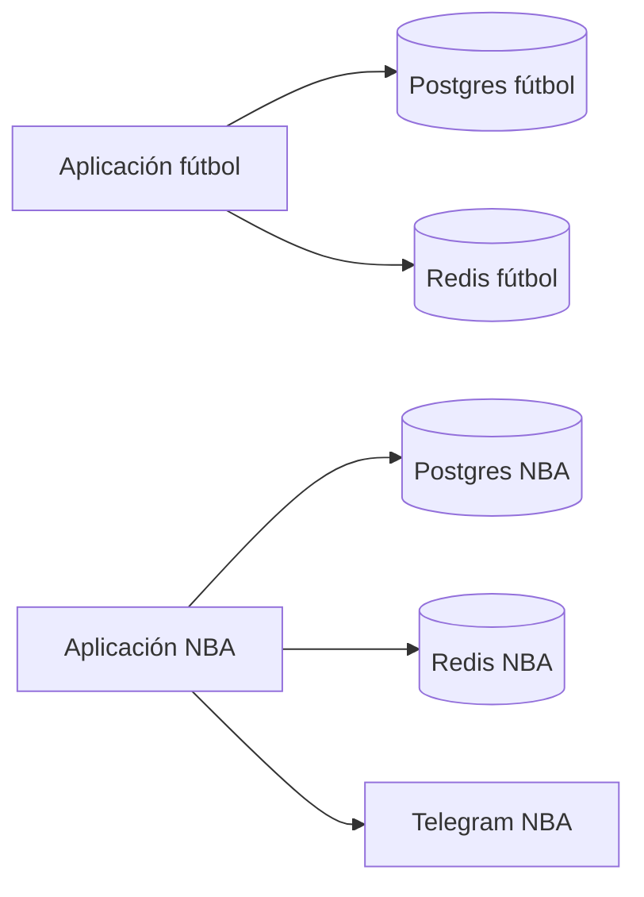

# NBA: arquitectura independiente del fútbol

Fecha: 3 de octubre de 2026. Estado: diseño recomendado; pendiente de implementación.

Esta especificación corresponde a F1 del [plan maestro auditable](nba_plan_fases_auditable.md), que fija dependencias, evidencia y puertas de avance.

La preocupación del usuario es evitar que incorporar NBA mezcle modelos, datos y procesos con fútbol. La propuesta es mantener un repositorio para organizar el trabajo y construir **dos aplicaciones con despliegues independientes**. No mover primero el código de fútbol ni convertir sus módulos en multideporte: construir NBA junto a él.

## 1. Motivos observados en el proyecto

- `src/qf/config.py` ejecuta `load_dotenv()` y define conexiones, modelo, presupuesto y publicación de fútbol. Importarlo desde NBA introduciría configuración implícita del otro deporte.
- `src/qf/db.py` depende de esos settings y crea un pool global hacia la base `quantfut`. Un import aparentemente útil puede terminar accediendo a esa base.
- `Dockerfile` instala las dependencias raíz, copia `src/` y arranca `qf.api.main`. Añadir NBA dentro de ese build acoplaría sus dependencias y despliegues.
- `docker-compose.yml` monta las migraciones de fútbol y comparte volúmenes entre API y worker. El worker utiliza `scripts/crontab`.
- Redis tiene política `allkeys-lru`: una outbox durable de alertas NBA no debe depender de una clave susceptible de expulsión ni competir por esa memoria.
- Esquema, triggers, selección, liquidación y puertas actuales contienen supuestos futbolísticos. Los conceptos de trazabilidad y point-in-time sirven como referencia; sus implementaciones no se importan automáticamente.

Estas son observaciones de archivos locales, sin inspección del servidor o de credenciales de producción.

## 2. Estructura propuesta

Las rutas NBA siguientes **no existen todavía**; representan la futura aplicación:

```text
src/qf/                   fútbol existente
db/                       migraciones de fútbol
tests/                    pruebas de fútbol
docker-compose.yml        despliegue de fútbol

apps/nba/
  src/nba/
    config.py
    db.py
    domain/               jugadores, partidos, periodos, contratos y pagos
    ingest/               calendario, box score, PBP, lesiones y cuotas
    model/                minutos, oportunidades y distribuciones
    eval/                 calibración, backtest y promoción NBA
    publish/              selección, sellado, outbox y Telegram
    api/                  lectura de resultados NBA si hace falta
  db/                     migraciones exclusivas NBA
  tests/                  pruebas y experimentos NBA
  requirements.txt        dependencias propias fijadas
  Dockerfile              imagen propia, sin copiar src/qf
  compose.yml             servicios y volúmenes propios
  .env.example            nombres de variables; sin secretos
  README.md               ejecución y recuperación propias
```

Entrenar, probar, construir y reiniciar NBA debe funcionar sin ejecutar los jobs de fútbol. Cada aplicación tendrá comandos de mantenimiento explícitos; no agregar NBA al cron o al setup de fútbol.

## 3. Fronteras de aislamiento

| Capa | NBA tendrá | Motivo |
|---|---|---|
| Código y dependencias | Paquete `nba`, entorno e imagen propios | Cambiar bibliotecas NBA no cambia el entorno de fútbol. Prohibir imports NBA→`qf` y fútbol→`nba`. |
| Persistencia | Instancia/contenedor Postgres propio, base `quantnba`, volumen y roles propios | Una migración NBA no recibe acceso a tablas de fútbol. Separar usuario de migraciones del usuario de ejecución. |
| Cola y caché | Instancia Redis propia, red y almacenamiento propios cuando sean necesarios | Separar presión de memoria, limpieza y reinicios. Outbox durable en Postgres NBA, con Redis solo como apoyo. |
| Modelos y auditoría | Artefactos, versiones, experimentos y cadena de sellado NBA | Un reentreno o corrección no sustituye artefactos ni historial de fútbol. |
| Ejecución | Workers y planificación independientes | Un fallo de ingesta NBA no interrumpe el worker diario de fútbol. Separar entrenamiento pesado de entrega live. |
| Configuración | Variables `NBA_*`, archivo explícito y validación al arrancar | Sin búsqueda implícita del `.env` raíz ni fallback a DSN, token o canal de fútbol. |
| Telegram | Bot/token y canal de pruebas NBA propios; publicación apagada al inicio | Separar credenciales, destinos, reintentos y límites de envío. El destino operativo de fútbol no será destino NBA. |
| Proveedores | Configuración, contabilidad y límite de consumo NBA | Evitar que la nueva captura agote créditos reservados a fútbol. |
| Promoción y riesgo | Política NBA por mercado, shadow, banca/exposición y reglas propias | No trasladar umbrales, persistencia o requisitos de tres ligas. |
| Operación | Proyecto Compose, redes, backups, métricas y recuperación NBA | Poder reconstruir o apagar NBA sin reiniciar fútbol ni restaurar sus datos. |

La separación solo por carpetas, prefijos de tablas o números de base Redis no satisface este objetivo. Redis documenta que sus bases lógicas comparten persistencia; no son instancias independientes. [Documentación Redis](https://redis.io/docs/latest/commands/select/).

Si posteriormente se opta por compartir una instancia Postgres para reducir consumo, bases y roles distintos con privilegios revisados ofrecen separación lógica, pero siguen compartiendo proceso, conexiones, disco y mantenimiento. No presentarlo como equivalente al diseño recomendado. [Privilegios PostgreSQL 16](https://www.postgresql.org/docs/16/ddl-priv.html).

## 4. Qué puede compartirse

Inicialmente: repositorio Git, documentación y principios matemáticos. Pueden usarse las mismas tecnologías sin utilizar las mismas instancias o configuraciones.

Más adelante, una utilidad pura de fechas, probabilidad o formato puede extraerse a una biblioteca pequeña con API estable, pruebas y versión fijada por aplicación. Debe carecer de imports de configuración, base de datos, red y reglas de un deporte. No extraer infraestructura compartida durante el primer piloto ni importar `qf.publish.telegram`, `qf.db` o `qf.config` para ahorrar líneas.

Una futura web conjunta puede consultar ambas APIs de lectura y distinguir deporte/contrato. Su indisponibilidad no debe detener captura, sellado ni envío NBA. No crear una nueva dependencia de ejecución entre modelos.

## 5. Límites que siguen existiendo



Aunque el diagrama separa aplicaciones, un mismo VPS conserva puntos comunes: kernel, Docker, disco, red y disponibilidad del host. Fijar límites de CPU/memoria y medir capacidad antes de instalar servicios adicionales. Docker no impone límites de recursos por defecto. [Documentación Docker](https://docs.docker.com/engine/containers/resource_constraints/). Para independencia del fallo del host, usar servidores distintos; esa decisión requiere comprobar costes y capacidad, no se toma mediante este documento.

Una API key distinta tampoco garantiza cuota distinta: el proveedor puede contabilizar por cuenta o suscripción. Verificar el ámbito real del límite. Si se comparte cuenta, reservar y contabilizar presupuesto global con un mecanismo coordinado o asignación verificable del proveedor; dos contadores locales independientes no bastan. El presupuesto NBA empieza deshabilitado hasta definir su tope; no consumir la reserva de fútbol.

Mantener volumen y retención NBA propios, pero vigilar espacio libre del host. Un volumen separado no impide llenar el disco compartido. Limitar entrenamiento y captura de forma que los servicios live conserven capacidad.

## 6. Orden de implementación y criterios de aceptación

1. Crear aplicación NBA, configuración explícita e imagen independientes; publicación y captura de pago deshabilitadas.
2. Crear persistencia y migraciones NBA, roles mínimos, volúmenes y recuperación propia en entorno local/de pruebas.
3. Ingesta y replay point-in-time; modelos en sombra y validación temporal.
4. Sellado, outbox, caducidad, revalidación y Telegram de pruebas con credenciales NBA.
5. Ensayos de aislamiento y capacidad; después promoción propia con evidencia.

Las pruebas pertinentes antes de operar son:

- Los paquetes no se importan entre sí y cada build utiliza solo sus fuentes/dependencias.
- Configuración NBA ausente o equivocada falla de forma explícita; no toma valores de fútbol.
- Las credenciales de runtime NBA no acceden a persistencia de fútbol y no ejecutan migraciones.
- Migraciones, backup y restauración NBA actúan solo sobre recursos NBA.
- Detener o hacer fallar workers/colas NBA en pruebas conserva el funcionamiento observado de fútbol; no ensayar caídas sobre producción.
- Carga NBA dentro de límites mantiene las métricas de fútbol dentro de sus objetivos definidos. Esto mide interferencia, no garantiza ausencia de cualquier fallo futuro.
- Una alerta NBA solo llega al destino NBA; reinicio/reintento respeta sellado, caducidad y deduplicación definida.

El despliegue y la activación no se han realizado. Esta especificación amplía el plan de investigación, fija límites concretos y evita una refactorización innecesaria del sistema existente.
